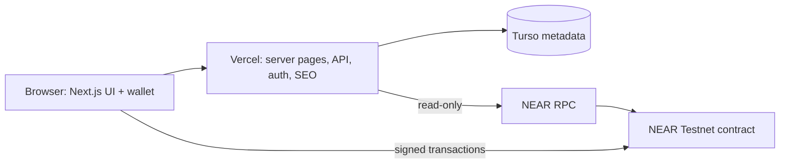

# GatherBond — Master Plan

> **Product:** Commitment-first event platform for real-world communities
> **Hackathon:** NEAR HACKATHON 2026 — Build Beyond Boundaries
> **Network:** NEAR Testnet only
> **Status:** Testnet v1.1 implemented and verified; SEO release candidate complete; production deploy of this candidate pending
> **Last updated:** 2026-11-13
> **Primary track:** Social Money (`social`)
> **Secondary:** Open Innovation (`open`), only if the final submission genuinely fits

This is the product strategy and scope document. The implementation truth is in the code, tests and [docs/DOCUMENTATION.md](./docs/DOCUMENTATION.md). When they disagree, the code and tests win and this plan is corrected.

---

## 1. The problem

Free event registration records intent, not commitment. No-shows waste venue capacity, food, planning effort and the chance for someone else to attend. Organizers respond with reminders, waiting lists or deposits handled off-platform, which are opaque and hard to enforce. Conventional tools cannot make attendance financially meaningful.

The deeper problem is trust: attendees cannot verify that a refund rule will be honored, and organizers cannot verify who will actually arrive.

## 2. The product

GatherBond makes the commitment real with a refundable native NEAR bond:

1. An organizer creates a room with a deposit, capacity, schedule and a metadata hash.
2. An attendee reserves by escrowing the exact deposit and committing to a one-time ticket.
3. The organizer checks attendees in at the door inside a fixed window.
4. After the room ends, the first claim settles it automatically.
5. People who showed up reclaim their bond and split the no-show pool. People who did not show up forfeit theirs.
6. If fewer than 20% of reservations attend, the room is treated as failed: everyone gets their deposit back and no pool is distributed.

The contract holds the money and the attendance record. The database holds display copy and can never override either.

## 3. Product principles

| Principle | Consequence |
| --- | --- |
| **The contract is the source of financial truth** | Deposits, capacity, attendance, settlement, claims and treasury are on chain |
| **Metadata is descriptive, not authoritative** | A database row can add a title, never a refund |
| **Fail closed** | Missing DB/RPC returns an error or hides the row; no sample data |
| **One commitment, one ticket** | Ticket secret stays in the browser; commitment is on chain |
| **No admin settlement** | The first claim settles an ended event; there is no organizer finalize button |
| **No platform cut** | The platform takes no deposit or no-show cut |
| **Permanent publication** | No unpublish button; corrections append a new version |
| **Verified discovery only** | Unverified rows are hidden, not shown with a warning badge |
| **Readable, not crypto-native** | Human account IDs, editorial UI and plain-language rules |

## 4. Users and jobs

### 4.1 Organizer

- “I want people who say yes to actually show up.”
- “I want the refund rule to be credible without chasing everyone.”
- “I want a public page I can share and a door check-in that takes seconds.”

### 4.2 Attendee

- “I want to commit without paying a platform fee or trusting a spreadsheet.”
- “I want my bond back when I show up.”
- “I want a ticket that works even if I switch browsers, via wallet recovery.”

### 4.3 Judge / observer

- “Show me a real contract, a real transaction and a real proof page.”
- “Show me that the displayed event cannot lie about money or attendance.”
- “Show me a reproducible test and a working deployment.”

### 4.4 Operator

- “I need to know whether the database, RPC, auth and contract are healthy.”
- “I need a release checklist that does not expose keys.”

## 5. Core loop and lifecycle

```text
create_event (organizer, storage contribution, metadata hash)
  → register (attendee, exact deposit, ticket commitment)
  → check_in (organizer, inside window, one-time secret)
  → event ends
  → claim_settlement (first claim auto-settles)
      ├─ ≥20% attendance: deposit + equal no-show share
      ├─ <20% attendance: full deposit for every reservation
      └─ cancelled: full deposit for every reservation
```

Contract status is `Open`, `Cancelled` or `Finalized`. “Settlement pending” is a UI state for an ended `Open` event. “Failed” is not a contract status; it is the below-floor settlement outcome.

## 6. Economics

Let `D` be the deposit, `N` registrations and `K` check-ins.

```text
pool       = (N - K) × D
reward     = floor(pool / K)          when K > 0
remainder  = pool - reward × K        → treasury

normal:     K × 5 >= N   → checked-in attendee gets D + reward
below floor K × 5 <  N   → every reservation gets D back
cancelled                → every reservation gets D back
empty (N = 0)            → no pool, no claim
```

The platform takes no cut. Exactly 20% passes the floor. The remainder accrues to the treasury, not to the organizer or the platform.

## 7. Scope: what v1 is

| Area | Included |
| --- | --- |
| Contract | Create, register, check in, rotate ticket, cancel, finalize, auto-settling claim, treasury, bounded views |
| Frontend | Discovery, event passport, recap/proof, organizer studio, commitments, wallet, QR/manual check-in, reserve, claim |
| Metadata | Canonical JSON, SHA-256, Turso/libSQL, append-only publication, verified-only discovery |
| Auth | NEP-413, Ed25519, full-access-key check, single-use nonce, HMAC session |
| SEO | Metadata, canonical, JSON-LD, sitemap, robots, noindex, OG cards, server-rendered event content |
| Ops | Health endpoint, fail-closed states, deploy runbook, verification script |
| Docs | README, system docs, metadata docs, SEO docs, deployment, security, build log, license |

## 8. Explicit non-goals for v1

- Mainnet deployment or real funds.
- Native mobile apps.
- NFT tickets or a marketplace.
- Organizer reputation, social graph or messaging.
- Fiat/card payments.
- Refundable deposits in arbitrary tokens.
- Admin CMS, analytics or a support console.
- Unpublish/delete.
- Multi-tenant organizations or team accounts.
- Automated physical access control.
- Independent audit (a post-hackathon requirement, not an MVP claim).

## 9. Architecture



- **Frontend:** Next.js App Router, React 19, plain CSS, Turbopack.
- **Contract:** Rust + NEAR SDK, wasm32-unknown-unknown.
- **Metadata:** Turso/libSQL in production, `node:sqlite` locally.
- **Auth:** NEP-413 + server-issued HMAC cookie.
- **Hosting:** Vercel; no server signing key.

## 10. Milestones

| Milestone | Scope | Status | Evidence |
| --- | --- | --- | --- |
| M0 | Repository, toolchain, build | Done | `BUILD_LOG.md` 2026-11-06/07 |
| M1 | Project definition and public repo shell | Done | `BUILD_LOG.md` |
| M2 | Complete escrow contract | Done | 54 contract tests, 415,893-byte artifact |
| M3 | Canonical metadata + Turso store | Done | 107 server tests, live Turso |
| M4 | Next.js metadata API over HTTP | Done | real HTTP e2e in `verify-local.sh` |
| M5 | NEP-413 sessions, rate limits, publication | Done | auth/session tests, live auth |
| M6 | Event passport, recap, studio, commitments | Done | production routes |
| M7 | QR check-in, gate mode, ticket recovery | Done | fixture pipeline + Testnet lifecycle |
| M8 | Lifecycle/concurrency hardening | Done | race tests, claim paths, 236 total tests |
| M9 | SEO + documentation release candidate | **Implemented, verified locally; deploy pending** | `docs/SEO.md`, 75 frontend tests, build 21 routes |
| M10 | Funded multi-account pilot | Open | requires two funded accounts and a live event |
| M11 | Independent audit + mainnet plan | Out of scope for hackathon | post-hackathon |

### M9 detail

- Root metadata, canonical origin, OpenGraph/Twitter, icons, manifest.
- Server-rendered verified listings and event/recap pages.
- `Event`, `Organization`, `WebSite`, `ItemList`, `WebPage` and `BreadcrumbList` JSON-LD.
- Verified-only sitemap; robots; noindex for private surfaces; real 404.
- Dynamic 1200×630 social cards.
- Nine SEO tests.
- Full documentation rewrite and MIT license.

## 11. Live snapshot (2026-11-13)

| Item | Value |
| --- | --- |
| Contract | `cynopom.testnet` |
| Event count | 8 on chain |
| Verified publications | 1 (`Sunday Table`, event 0) |
| Database | Turso, `database_read: ok` |
| Auth | configured |
| Tests | 54 contract + 8/8 vectors + 75 frontend + 107 server |
| Build | exit 0, 21 routes |
| SEO production status | release candidate not yet pushed/deployed |

The seven extra on-chain events are development/acceptance records. Discovery hides them because they lack a current verified publication. This is the fail-closed design, not a bug.

## 12. Roadmap

### Phase 1 — Before submission (hackathon)

- [x] Live contract and frontend
- [x] Verified event, hash and recap
- [x] 236-test verification and 21-route build
- [x] SEO implementation and docs
- [x] MIT license
- [ ] Push/deploy the SEO release candidate (requires human authorization)
- [ ] Verify production SEO routes after deploy
- [ ] Record demo video/screenshots for the human's X post
- [ ] Human confirms the submission payload

### Phase 2 — After the hackathon (pilot)

- Funded two-account, two-browser pilot with a real small event.
- Physical printed QR check at a door.
- Shared nonce/rate-limit store for multiple replicas.
- Search Console/Bing verification and rich-results validation.
- Better organizer analytics (read-only, contract-derived).
- Optional event image upload with moderation (not in v1).

### Phase 3 — Before any mainnet

- Independent audit and remediation.
- Mainnet deployment and incident runbook.
- Privacy/terms/legal review.
- Capped real-funds pilot with monitoring and on-call.
- Key management with a hardware/MPC signer.
- Reputation and dispute policy for organizer check-in.

## 13. Success metrics

Hackathon success is evidence, not vanity metrics:

| Metric | Target |
| --- | --- |
| Contract tests | ≥50 passing |
| Cross-language ticket vectors | 8/8 |
| Full local suite | 100% passing |
| Build | 0 errors |
| Live contract | reachable, correct identity |
| Verified publication | at least one with a public recap |
| Crawlable event page | title, canonical, JSON-LD, OG, 200 |
| Missing event | HTTP 404 |
| Private route | noindex |
| Documentation | judge can reproduce the result without reading chat |

Post-hackathon pilot metrics (not yet measured):

- show-up rate versus a free-registration baseline;
- time to check in one attendee;
- claim completion rate;
- organizer repeat rate;
- support incidents per event.

Do not claim these before measuring them.

## 14. Risks and mitigations

| Risk | Impact | Mitigation |
| --- | --- | --- |
| Organizer check-in trust | False attendance | Disclosed assumption; door process; future attestations |
| Metadata operator withholds | Listing unavailable | Contract remains usable; no financial impact |
| RPC outage | Event pages fail closed | Explicit offline state; retry; no cached guess |
| Process-local rate limits | Multi-replica abuse | Documented; shared store before scaling |
| Testnet contract key custody | Deploy risk | Key not in workspace; maintainer-held; no mainnet |
| Panic-abort error opacity | Poor rejection UX | Client-side validation; documented limitation |
| Participant no-shows | Empty room | The product’s purpose; floor protects everyone |
| SEO overclaim | Judge distrust | Verified-only data; exact evidence; no fake reviews/offers |
| Scope creep | Unfinished demo | Non-goals list; milestone gate |

## 15. Decision log

| Date | Decision | Reason |
| --- | --- | --- |
| 2026-11-06 | Native NEAR escrow, no platform balance | Auditable, simple custody |
| 2026-11-07 | Pull claims with callbacks | One failure cannot block the room |
| 2026-11-07 | Metadata hash anchored at creation | Database cannot rewrite terms |
| 2026-11-08 | Versioned publication, permanent | History and no silent disappearance |
| 2026-11-10 | Auto-settle on first claim | Remove admin finalize dependency |
| 2026-11-11 | Verified-only discovery | No sample or unverified rows |
| 2026-11-12 | Organizer-chosen windows, validated order | Real scheduling flexibility |
| 2026-11-13 | Server-render event/listing, JSON-LD, verified sitemap | Crawlability without lying |
| 2026-11-13 | Private routes noindex | Wallet surfaces are not search content |

## 16. Demo script for judges

1. **Problem (20s):** free RSVPs do not create commitment; no-shows waste rooms.
2. **Mechanic (30s):** deposit → check-in → auto-settle; below 20% everyone is refunded.
3. **Live proof (60s):** health, event count, verified event, hash, NEARBlocks transaction, recap.
4. **Trust (45s):** show `metadata_hash` on chain, canonical JSON, verified-only discovery, fail-closed 503.
5. **SEO (30s):** view source on event, sitemap, robots, dynamic OG.
6. **Evidence (30s):** 236 tests, 21-route build, 54 contract tests.
7. **Honesty (20s):** testnet only, no audit, multi-account pilot still open.

## 17. Documentation map

| Doc | Purpose |
| --- | --- |
| [README.md](./README.md) | Judge/user entry point, live proof, 5-minute path |
| [docs/DOCUMENTATION.md](./docs/DOCUMENTATION.md) | Authoritative system guide |
| [docs/SEO.md](./docs/SEO.md) | Metadata, structured data, sitemap and crawl operations |
| [docs/METADATA.md](./docs/METADATA.md) | Canonical JSON, publication and verification API |
| [docs/DEPLOY_RUNBOOK.md](./docs/DEPLOY_RUNBOOK.md) | Contract acceptance and frontend release |
| [BUILD_LOG.md](./BUILD_LOG.md) | Append-only verified history |
| [CONTRIBUTING.md](./CONTRIBUTING.md) | Workflow and checks |
| [SECURITY.md](./SECURITY.md) | Trust model and reporting |
| [HACKATHON.md](./HACKATHON.md) | Organizer rules; unchanged |

## 18. Operating rules for agents and contributors

- Read `HACKATHON.md` (unchanged), this file, `BUILD_LOG.md`, and `README.md` before changing scope.
- The contract and tests are the implementation truth. Never claim a milestone is complete without evidence.
- Do not change economics, timing rules or trust boundaries without a product decision and tests.
- Do not deploy, push, spend funds, sign transactions or publish a submission without explicit human authorization.
- Fail closed. Never add demo data to cover a missing dependency.
- Keep `HACKATHON.md` unchanged.
- Append verified work to `BUILD_LOG.md`; do not rewrite history.
- When docs and code disagree, fix the docs or the code deliberately; do not paper over the gap.

---

**License:** MIT. **Network:** Testnet only. **No real funds.**
