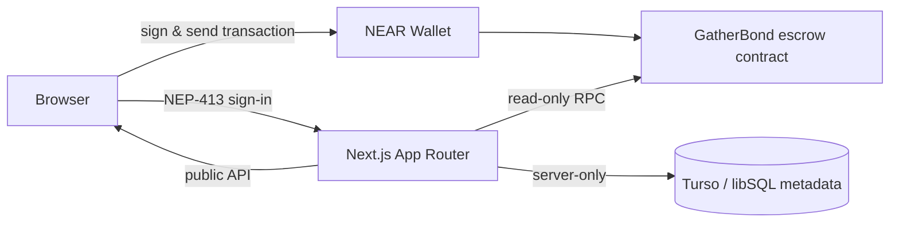

# GatherBond

**Commit to gather. Earn by showing up.**

GatherBond is a commitment-first event platform on NEAR. Organizers create real-world events with a refundable native NEAR deposit. Attendees reserve with the exact deposit, receive a one-time ticket, and get checked in by the organizer. After the event, verified attendees claim their deposit plus a share of the no-show pool. The contract holds the money, records attendance and settles deterministically; the database only stores descriptive metadata.

> **Status:** Testnet v1 is live. The contract is `cynopom.testnet`, the production frontend is <https://gatherbond.vercel.app>, and the Turso metadata layer, NEP-413 wallet sessions and QR check-in are enabled. This is a testnet product: no mainnet funds are used and the contract is not audited.

[](https://gatherbond.vercel.app)
[](https://testnet.nearblocks.io/address/cynopom.testnet)
[](https://near.org)
[](./docs/DOCUMENTATION.md)

## Why GatherBond exists

Free event registrations are cheap promises. A no-show wastes a seat, a venue, food, a coach and someone else's chance to attend. GatherBond makes the commitment real without turning the event into a ticketing business:

- the deposit is refundable when the attendee shows up,
- no-shows fund the people who did,
- every rule, registration and settlement is readable on chain,
- the organizer never holds attendee money.

## How it works

1. **Reserve.** The attendee connects a NEAR Testnet wallet and sends the exact deposit to the escrow contract.
2. **Show up.** The attendee receives a one-time `GB1.` QR ticket. The organizer scans it (or pastes the code) inside the check-in window, and the contract records attendance.
3. **Settle.** After the event ends, anyone can finalize it. Checked-in attendees claim their deposit plus their share of the no-show pool. Cancelled events refund the full deposit.

## Live surfaces

| Surface | URL |
| --- | --- |
| Production app | <https://gatherbond.vercel.app> |
| Contract | [`cynopom.testnet`](https://testnet.nearblocks.io/address/cynopom.testnet) |
| Health | <https://gatherbond.vercel.app/api/health> |
| Config | <https://gatherbond.vercel.app/api/config> |
| Repository | <https://github.com/auntor69/gatherbond-near-hackathon-2026> |

The live contract currently returns **3** events; event `0` (`Sunday Table`) is a published, verified listing backed by the Turso metadata layer.

## What is live today

| Area | Implemented |
| --- | --- |
| Escrow contract | Event creation, exact-deposit registration, capacity, ticket commitments, organizer check-in, ticket rotation, cancellation, permissionless finalization, pull claims, treasury accounting, pagination and failed-transfer recovery |
| Organizer flow | Wallet session, create event, store canonical metadata, publish a versioned snapshot, load a draft, check in attendees, finalize or cancel |
| Attendee flow | Wallet session, reserve, one-time QR ticket, download/copy fallback, commitments view, recovery with a fresh ticket commitment, claim settlement |
| Public proof | Verified event passport, on-chain terms, Flake Fund projection, finalized recap, attendee receipt, public metadata API |
| Metadata | Canonical JSON + SHA-256, append-only publish/unpublish versions, verified published-only discovery |
| Auth | NEP-413 signature verification, single-use nonces, HttpOnly HMAC session cookie, full-access-key check, rate limits |
| UI | Nocturne design system, responsive layouts at 390/768/1024/1440, reduced-motion support, self-hosted Instrument Sans/Serif |

## Architecture



- The **contract** is authoritative for organizer, deposit, capacity, schedule, reservations, ticket commitments, attendance, cancellation, finalization, escrow, rewards and claims.
- **Turso/libSQL** stores only descriptive metadata and its SHA-256. It can never prove payment, attendance or claim entitlement.
- **Server-side auth** derives the metadata-write actor from a verified wallet session. No server key signs transactions and no client can choose its own actor.
- **Local development** can run the same metadata layer over SQLite instead of Turso.

## Stack

| Layer | Choice |
| --- | --- |
| Contract | Rust + `near-sdk`, one escrow contract (`gatherbond-escrow`) |
| Network | NEAR Testnet only |
| Frontend | Next.js 16 App Router, React 19, Turbopack, plain CSS design system |
| Wallet | `@hot-labs/near-connect`, NEP-413 message signing |
| Metadata | Node ESM modules, `node:sqlite` locally, Turso/libSQL in production |
| QR | `qrcode` for rendering, `BarcodeDetector` + `jsqr` for Gate Mode |
| Hosting | Vercel Git integration (`main`) |

## Repository map

```text
contracts/            Rust escrow contract + tests
database/             SQL migration for the metadata layer
docs/                 deployment, metadata and full documentation
frontend/             Next.js app, components, client libs, public assets
local/                private working notes (not tracked)
scripts/              verification, metadata and deploy handover tools
server/               auth, metadata, HTTP and NEAR RPC modules
BUILD_LOG.md          verified implementation history
MASTERPLAN.md         product, architecture and milestone plan
```

## Run it locally

```bash
git clone https://github.com/auntor69/gatherbond-near-hackathon-2026.git
cd gatherbond-near-hackathon-2026

# frontend
cd frontend
npm install
cp ../.env.example .env.local   # then fill in only the values you need
npm run dev
```

Open <http://localhost:3000>. Without a configured contract the UI fails closed: it disables create/reserve and reports the missing configuration instead of substituting sample data.

For a database-free local run, set `METADATA_SQLITE_PATH=.data/gatherbond.sqlite` and omit the Turso variables. The metadata layer is optional; escrow remains usable without it.

## Environment

The complete annotated template lives in [`.env.example`](./.env.example). Never commit `frontend/.env.local` or any token.

| Variable | Scope | Purpose |
| --- | --- | --- |
| `NEXT_PUBLIC_NEAR_NETWORK_ID` | browser | Network label, `testnet` |
| `NEXT_PUBLIC_NEAR_NODE_URL` | browser | NEAR RPC endpoint |
| `NEXT_PUBLIC_CONTRACT_NAME` | browser | Contract account for wallet calls |
| `CONTRACT_NAME` | server | Server-side contract account (falls back to the public name) |
| `NEAR_NETWORK_ID` | server | Network identity used in route keys |
| `NEAR_RPC_URL` | server | Read-only RPC used to verify metadata hashes |
| `TURSO_DATABASE_URL` | server only | Production metadata database |
| `TURSO_AUTH_TOKEN` | server only | Turso credential; never sent to the browser |
| `METADATA_SQLITE_PATH` | server only | Local SQLite database for development/tests |
| `GATHERBOND_SESSION_SECRET` | server only | HMAC secret for session cookies (32+ chars) |
| `GATHERBOND_AUTH_RECIPIENT` | server | NEP-413 recipient string wallets sign |
| `GATHERBOND_SESSION_TTL_SECONDS` | server | Session lifetime, default `7200` |
| `GATHERBOND_SECURE_COOKIES` | server | Set to `1` on HTTPS production |
| `GATHERBOND_LOGIN_RATE_LIMIT` / `GATHERBOND_LOGIN_ACCOUNT_RATE_LIMIT` | server | Login throttling |
| `GATHERBOND_WRITE_RATE_LIMIT` | server | Per-actor metadata-write throttling |
| `GATHERBOND_RATE_LIMIT_DISABLED` | test only | Never set in a deployed environment |
| `GATHERBOND_ALLOW_DEV_ACTOR` | test only | Never set in a deployed environment |

## Verify

```bash
bash scripts/verify-local.sh          # contract + parity + display/QR + metadata/auth/HTTP e2e + deploy handover
npm run build --prefix frontend       # production Next build
```

The latest verified local run passed all six steps:

```text
50 contract tests
8/8 ticket-commitment vectors
39 Flake Fund + contract display/schedule math + QR round-trip tests
94 Node metadata/auth/HTTP tests (including live Next + SQLite end-to-end)
production Next build: /events/[id]/recap present
deploy handover: 17 required methods, 414,933-byte WASM
```

The frontend was additionally checked at 390, 768, 1024 and 1440 px across home, event detail, recap, studio, commitments and not-found: zero horizontal overflow, no text outside its viewport, all headings visible and sticky panels reachable.

## Contract surface

| Group | Methods |
| --- | --- |
| Lifecycle | `new`, `fund_reserve`, `create_event`, `register`, `check_in`, `rotate_ticket_commitment`, `cancel_event`, `finalize_event`, `claim_settlement`, `withdraw_treasury` |
| Callbacks | `on_claim_callback`, `on_treasury_callback` |
| Views | `get_event`, `get_events`, `get_event_count`, `get_reservation`, `get_reservations_for_account`, `get_attendance_history`, `get_treasury_balance`, `get_total_liability`, `get_pending_amount`, `get_storage_stake`, `get_required_balance`, `get_surplus`, `get_last_storage_delta`, `get_max_record_bytes`, `get_treasury_account`, `get_network_id` |

Every money movement is covered by the invariant `balance >= total_liability + pending_total + storage_stake + buffer`. See [`docs/DOCUMENTATION.md`](./docs/DOCUMENTATION.md#smart-contract) for the full accounting and storage policy.

## API

| Route | Auth | Purpose |
| --- | --- | --- |
| `GET /api/config` | public | Network and contract identity |
| `GET /api/health` | public | Database mode, auth configuration, contract configuration |
| `GET /api/contract/event-count` | public | On-chain event count |
| `GET /api/events` | public | Published, verified listings only |
| `GET /api/events/:id` | public | Verified publication + read-only on-chain terms |
| `GET /api/events/:id/publication` | public | Current published snapshot |
| `GET /api/events/:id/metadata` | public | Draft/verification read for the organizer flow |
| `PUT /api/events/:id/metadata` | organizer session | Save/replace the draft after `create_event` |
| `POST /api/events/:id/publication` | organizer session | Publish the current draft |
| `DELETE /api/events/:id/publication` | organizer session | Append an unpublish tombstone |
| `POST /api/auth/session` | public | NEP-413 login |
| `GET /api/auth/session` | cookie | Current session / auth config |
| `DELETE /api/auth/session` | cookie | Logout |
| `GET /api/me/commitments` | wallet session | Reservations + on-chain event state for the signed-in account |

All authenticated responses are `no-store`. The metadata database is never a source of financial truth.

## Security and truth boundary

- **Wallet session:** the server verifies a NEP-413 signature over a domain-separated message, checks the key is a full-access key through read-only RPC, consumes a single-use nonce, and issues an HttpOnly `SameSite=Lax` HMAC cookie. No client-supplied account id is trusted for writes.
- **Financial authority:** only the contract decides deposits, refunds, rewards, attendance and claims. Metadata rows cannot change money.
- **Ticket secrecy:** the secret stays in the attendee's browser; only its SHA-256 commitment is on chain. Rotation invalidates the old QR immediately.
- **Fail closed:** missing database, RPC or session secret returns an explicit `503`/`401`; the app never invents balances or success states.
- **Testnet only:** no mainnet deployment procedure exists in this repository.

## Design system

The frontend uses **Nocturne**: bone/ink surfaces, ember and cobalt accents, a sharp editorial grid, Instrument Sans and Instrument Serif, and compact header/footer chrome. Motion is deliberate and non-content-hiding: a hero entry, a ticker, a floating pass card and hover lifts, all collapsed to their final state under `prefers-reduced-motion`. Legacy styles remain as a compatibility layer; `nocturne.css` loads last and owns the final visual language.

## Deployment

- **Frontend:** Vercel Git integration on `main`. Production URL: <https://gatherbond.vercel.app>.
- **Contract:** NEAR Testnet at `cynopom.testnet`. The current WASM is 414,933 bytes with SHA-256 `8b8817aa9da9f0a0784a9059f59e3c2640c26c9228648b2196a306e78c54e1f0`.
- **Metadata:** Turso/libSQL, migrated with `database/migrations/0001_event_metadata.sql`.
- Full procedure: [`docs/DEPLOY_RUNBOOK.md`](./docs/DEPLOY_RUNBOOK.md).

## Status and limitations

Implemented and verified locally; one funded single-account Testnet acceptance run is recorded in [`BUILD_LOG.md`](./BUILD_LOG.md). Still open:

- a funded multi-account Testnet pilot with published metadata and two browsers,
- a physical camera scan (the current camera test used the active pipeline with a fixture),
- independent contract audit and production hardening before any mainnet consideration,
- a shared rate-limit store if the app is ever scaled to multiple instances.

## Documentation

- [`docs/DOCUMENTATION.md`](./docs/DOCUMENTATION.md) — complete system documentation.
- [`docs/METADATA.md`](./docs/METADATA.md) — canonical metadata and publication API.
- [`docs/DEPLOY_RUNBOOK.md`](./docs/DEPLOY_RUNBOOK.md) — contract + frontend release runbook.
- [`MASTERPLAN.md`](./MASTERPLAN.md) — product, economics and milestone plan.
- [`BUILD_LOG.md`](./BUILD_LOG.md) — verified implementation history.
- [`CONTRIBUTING.md`](./CONTRIBUTING.md) — development workflow and standards.
- [`SECURITY.md`](./SECURITY.md) — security model and reporting.
- [`HACKATHON.md`](./HACKATHON.md) — organizer-provided hackathon rules (kept unchanged).

## License and attribution

No open-source license has been selected for this repository yet; treat the code as all rights reserved until the maintainer adds one. Bundled Instrument Sans and Instrument Serif font files are licensed under the SIL Open Font License (see `frontend/public/fonts/OFL-*.txt`). Open-source dependencies keep their own licenses.
