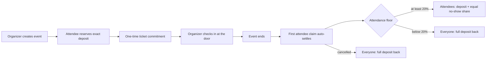
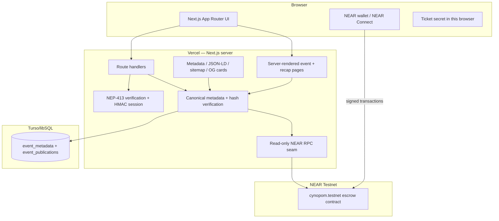

# GatherBond

**Commit to gather. Earn by showing up.**

GatherBond is a commitment-first event platform on **NEAR Testnet**. Organizers create real-world rooms with a refundable native NEAR deposit. Attendees reserve with the exact deposit and receive a one-time ticket. The organizer checks them in at the door. After the room ends, the first attendee claim settles the event automatically: people who showed up reclaim their bond and split the no-show pool; people who did not show up forfeit theirs.

The contract holds the money and records attendance. The database stores descriptive metadata and can never override a deposit, a check-in, a refund or a claim.

> **Judge summary:** the app is live, the contract is live, the money path is on-chain, and every listing shown in discovery is re-hashed against the contract before it is rendered. This is a Testnet prototype with no real funds and no audit.

[](https://gatherbond.vercel.app)
[](https://testnet.nearblocks.io/address/cynopom.testnet)
[](#verification)
[](#verification)
[](./LICENSE)

---

## Why this is not another event page

| Ordinary registration | GatherBond |
| --- | --- |
| A button records intent. | A native NEAR deposit escrows the commitment. |
| No-shows cost the host. | No-show deposits fund the people who attended. |
| Attendance is a dashboard row. | Attendance is an on-chain boolean written by the organizer inside a fixed window. |
| Refund policy is prose. | Refund and reward amounts are integer contract rules. |
| Event details are trusted because a database says so. | Display metadata is verified against the SHA-256 hash anchored at `create_event`. |
| Settlement needs an admin. | The first attendee claim settles an ended event automatically. |

The design goal is not “tickets on a blockchain.” It is a closed economic loop where **showing up is the only way to get the bond back**, and anyone can audit why.

---

## Live proof

| Surface | Value |
| --- | --- |
| Production app | <https://gatherbond.vercel.app> |
| NEAR Testnet contract | [`cynopom.testnet`](https://testnet.nearblocks.io/address/cynopom.testnet) |
| Metadata database | Turso/libSQL, `database_mode: turso`, `database_read: ok` |
| Wallet sessions | NEP-413, HttpOnly HMAC cookie, enabled |
| On-chain events created | **8** (development and acceptance runs) |
| Verified public snapshots | **1** currently indexed — `Sunday Table`, event `0` |
| Published metadata hash | `e0257fe70d537f0ca6e6eb6c2851210833039cb76b6fc740e655f213232d99fc` |
| Create transaction | [`2xymPbgCGRsEXZMFxYhhmqJFKuXt6x5nTop3TyHBDk5a`](https://testnet.nearblocks.io/txns/2xymPbgCGRsEXZMFxYhhmqJFKuXt6x5nTop3TyHBDk5a) |
| Contract artifact | 415,893-byte WASM, SHA-256 `af6b8bbc13c9ec589345a50df62ab73183033d5ad15b71da1deff96e4691da4b` |
| Local verification | 54 contract + 8/8 vectors + 75 frontend + 107 server tests = **236 passing** |

**Why only one event is listed when eight exist on chain:** discovery is deliberately fail-closed. An event is visible only when its stored JSON still hashes to its stored digest **and** that digest equals the `metadata_hash` anchored on chain. The other seven events are development/acceptance records without a current verified publication. They are not replaced with demo rows.

Verified on 2026-11-13 against `/api/health`, `/api/events`, `/api/contract/event-count` and `/api/events/0`.

---

## The 5-minute judge path

Everything below can be checked before connecting a wallet. Each row is an action followed by the observable result.

| Do this | See this |
| --- | --- |
| Open <https://gatherbond.vercel.app> | A server-rendered listing for **Sunday Table**. It is there in the HTML, not only after client JavaScript. |
| Open the listing | An event passport with the contract’s deposit, capacity, schedule, status and metadata hash. The create transaction links to NEARBlocks. |
| Open **View room proof** on the ended event | A public recap with registered/checked-in counts and the settlement outcome. No attendee identities are exposed. |
| View source on the event page | `<title>`, canonical, OpenGraph/Twitter tags and schema.org `Event` JSON-LD for the verified publication. |
| Open <https://gatherbond.vercel.app/sitemap.xml> | Only the home page, the verified event and its closed recap. Drafts and unverified rows cannot enter the sitemap. |
| Open <https://gatherbond.vercel.app/robots.txt> | Public rooms allowed; `/api/`, `/studio` and `/commitments` disallowed. |
| Open `/studio` or `/commitments` and view source | `noindex, nofollow`, because both surfaces are wallet/private state. |
| Open an unknown event such as `/events/999999` | A real HTTP **404**, not a 200 shell with an error message. |
| Call `/api/health` | Database, auth and contract readiness in one JSON response. |
| Call `/api/events` | Only verified published rows; `skipped` counts rows that failed verification. |

A full reserve → check-in → claim run needs funded Testnet accounts, a wallet signature and an organizer check-in. It is documented step by step in [docs/DEPLOY_RUNBOOK.md](./docs/DEPLOY_RUNBOOK.md), not faked in the UI.

---

## How the mechanic works



1. **Create.** The organizer chooses a deposit, capacity (1–500), start/end, registration deadline and check-in window. The contract requires `now < start < end`, registration in the future and no later than start, and check-in opening after registration closes and closing by the end. A non-refundable storage contribution is attached (contract minimum 0.01 NEAR; the studio default is 0.1 NEAR).
2. **Reserve.** The attendee sends exactly `deposit` in yoctoNEAR plus a 32-byte ticket commitment. The secret behind the ticket never goes on chain.
3. **Check in.** Only the organizer can mark attendance, only inside the window and only with the matching secret. A ticket is one-time-use.
4. **Settle.** `claim_settlement` on an ended `Open` event calls the same settlement logic as `finalize_event`; the first claim freezes the pools. At or above 20% attendance, each checked-in attendee receives `deposit + floor(no-show deposits / checked-in)`. Below 20% (including zero check-ins), every reservation, including no-shows, receives its full deposit and no pool is distributed.
5. **Claim.** Payouts are individual pull withdrawals with a per-event single-flight lock. A failed transfer restores the entitlement; one attendee cannot block another event.

`finalize_event` remains permissionless for tooling and indexers. The product does **not** require or expose an organizer finalize button.

### Economics in one line

```text
invariant: balance >= Σ(refund_pool + reward_pool) + treasury_accrued
                    + pending_payouts + storage_stake + buffer
```

The contract checks this invariant whenever a state change can affect solvency. Registration growth must be covered by pre-existing surplus, never by another attendee’s refundable deposit.

---

## Why NEAR

- **Native escrow:** the deposit is the asset. No wrapped token, no platform balance, no custody layer.
- **Predictable fees:** small Testnet transfers make a refund/reward loop practical.
- **Human-readable accounts:** organizers and attendees are account IDs, not opaque addresses.
- **Fast finality:** check-in and attendance updates are visible immediately at the door.
- **Wallet-native auth:** NEP-413 signs a human-readable login message; the server verifies a full-access key through read-only RPC and issues its own session.

---

## Architecture



### Trust boundary

| Layer | Authoritative for | Never authoritative for |
| --- | --- | --- |
| NEAR contract | deposits, capacity, registration, attendance, cancellation, settlement, rewards, claims, treasury | display copy, images |
| Metadata database | title, description, category, venue, image URL, tags, publication history | money, attendance, eligibility |
| Server | wallet-session verification, canonical hashing, HTTP orchestration, SEO rendering | user funds, user signatures |
| Organizer | door check-in in this MVP | changing a deposit, rewriting attendance after the fact, touching the pool |
| Browser | ticket secret and wallet interaction | another user’s ticket or balance |

A metadata operator can withhold a listing. It cannot make someone paid, checked in, refundable or settled.

---

## Contract surface

Core methods on `cynopom.testnet`:

| Method | Caller | Purpose |
| --- | --- | --- |
| `create_event` | organizer | Create immutable terms + anchor `metadata_hash`; requires storage contribution |
| `register(event_id, ticket_commitment)` | attendee | Escrow the exact deposit and bind a one-time ticket |
| `check_in(event_id, attendee, secret)` | organizer | Verify the commitment and mark attendance inside the window |
| `rotate_ticket_commitment` | attendee | Replace a lost ticket before check-in closes |
| `cancel_event` | organizer | Cancel before start; full refunds |
| `finalize_event` | anyone | Permissionless settlement for tooling/indexers |
| `claim_settlement` | attendee | Auto-settle an ended event if needed, then pull the entitlement |
| `withdraw_treasury` | treasury | Withdraw accrued rounding remainder only |
| `get_event`, `get_events`, `get_event_count` | anyone | Public event views |
| `get_reservation`, `get_reservations_for_account`, `get_attendance_history` | anyone | Bounded reservation/attendance views |
| `get_total_liability`, `get_pending_amount`, `get_storage_stake`, `get_required_balance`, `get_surplus` | anyone | Solvency and storage observability |

The deploy handover checks **17 required methods** and the `(treasury, network_id)` init arguments. Full details: [docs/DOCUMENTATION.md](./docs/DOCUMENTATION.md#smart-contract).

### Ticket commitment

```text
SHA-256(
  "GatherBond:v1"
  || u32le(len(network_id)) || network_id
  || u32le(len(contract_id)) || contract_id
  || u64le(event_id)
  || u32le(len(attendee)) || attendee
  || u32le(len(secret)) || secret
)
```

Rust and JavaScript are checked against the same 8 known-answer vectors by `scripts/verify-local.sh`. The secret is never stored on chain and never placed in a URL.

---

## Metadata and publication

The canonical document is JSON with sorted keys and no whitespace. Its SHA-256 is anchored on chain. The database stores that document and an append-only publication log.

Key rules:

- Only descriptive fields are allowed. Financial fields such as `deposit`, `capacity`, `registered` or `claimed` are rejected.
- The server re-hashes the stored JSON on every read.
- The server reads `get_event(event_id)` and compares the on-chain `metadata_hash`.
- A mismatch returns `409`; the row is hidden from discovery and never rendered as verified.
- Publishing appends a version. An unchanged republish is an idempotent no-op. There is no unpublish or delete action in the UI or current API.
- A draft is not public. Discovery reads only the current published snapshot.

Deep reference: [docs/METADATA.md](./docs/METADATA.md).

---

## HTTP API

| Route | Methods | Auth | Notes |
| --- | --- | --- | --- |
| `/api/health` | GET | public | Database/auth/contract readiness; no secrets |
| `/api/config` | GET | public | Network and contract identity |
| `/api/contract/event-count` | GET | public | Live on-chain count |
| `/api/events` | GET | public | Verified published list; supports `limit`, `offset`, `category` |
| `/api/events/[id]` | GET | public | Verified publication + public contract terms |
| `/api/events/[id]/metadata` | GET, PUT | PUT requires wallet session | Draft verification / write |
| `/api/events/[id]/publication` | GET, POST | POST requires organizer session | Public snapshot / append publication |
| `/api/auth/session` | POST, GET, DELETE | public | NEP-413 login, whoami, logout |
| `/api/me/commitments` | GET | wallet session | Reservations for the authenticated account only |

All responses use `cache-control: no-store` unless explicitly cached by the route. Missing configuration fails closed with `503`; it never returns sample data.

---

## SEO and crawlability

The public surface is built for humans **and** crawlers, without inventing events.

| Surface | Implementation |
| --- | --- |
| Root metadata | `metadataBase`, title template, description, keywords, canonical, robots, OpenGraph, Twitter, manifest, icons |
| Home | Server-rendered verified shelf + `Organization`, `WebSite` and `ItemList` JSON-LD; 60-second ISR |
| Event page | Server-rendered verified event + dynamic `generateMetadata` + schema.org `Event` + canonical + per-event OG image |
| Recap | Server-rendered proof, canonical, `WebPage`/`BreadcrumbList` JSON-LD, indexable only after the room closes |
| Private routes | `/studio` and `/commitments` are `noindex, nofollow` and disallowed in `robots.txt` |
| Sitemap | Verified event pages and closed recaps only; paginates the verified publication list |
| 404 | Real HTTP 404 with Next’s noindex |
| Social cards | Branded 1200×630 root card and dynamic event card with title/date/venue |
| Failure mode | If metadata or RPC is unavailable, the sitemap/JSON-LD/event page omit data rather than fabricate it |

Canonical origin is controlled by `NEXT_PUBLIC_SITE_URL` and defaults to `https://gatherbond.vercel.app`. Full operational notes: [docs/SEO.md](./docs/SEO.md).

---

## Stack

- **Frontend:** Next.js 16.4.5 App Router, React 19.3.1, plain CSS design system, Turbopack.
- **Contract:** Rust + NEAR SDK, `wasm32-unknown-unknown`, 54 tests.
- **Metadata:** Turso/libSQL in production, `node:sqlite` locally, append-only publication log.
- **Auth:** NEP-413 signed login, Ed25519 verification, read-only full-access-key check, HMAC HttpOnly session.
- **Wallet:** `@hot-labs/near-connect`.
- **Tests:** `node --test` for frontend/server, `cargo test` for the contract, known-answer vectors cross-language.
- **Hosting:** Vercel; no server signing key.

---

## Repository map

```text
contracts/                 Rust escrow contract + 54 tests
database/migrations/       Turso/libSQL schema
docs/                      system, metadata, SEO, deployment docs
frontend/app/              App Router pages, API routes, metadata routes
frontend/components/       UI, wallet, QR, reserve/check-in/claim surfaces
frontend/lib/              display mapping, event state, contract math, SEO, ticket crypto
server/metadata/           canonical JSON, hashing, store, handlers, runtime
server/auth/               NEP-413, sessions, nonces
server/http/               framework-agnostic routes, limits, Next runtime
server/near/               read-only RPC client
scripts/                   verification and deploy handover
```

---

## Run it locally

### Prerequisites

- Node.js 22+ (the project uses built-in `node:sqlite` for local tests)
- Rust toolchain with `wasm32-unknown-unknown` for contract work
- NEAR CLI only if you intend to deploy or exercise the contract manually
- A NEAR Testnet wallet for wallet flows

### Frontend

```bash
cd frontend
npm install
cp ../.env.example .env.local
# Fill TURSO_* for the hosted database, or set METADATA_SQLITE_PATH=.data/gatherbond.sqlite
npm run dev
```

Open <http://localhost:3000>. Without a database, public discovery and metadata pages fail closed with an explicit `503`; the contract itself is unaffected.

### Contract

```bash
cd contracts
cargo fmt --check
cargo test --offline
```

### Environment

| Variable | Required | Purpose |
| --- | --- | --- |
| `NEXT_PUBLIC_NEAR_NETWORK_ID` | yes | `testnet` |
| `NEXT_PUBLIC_NEAR_NODE_URL` | yes | Wallet RPC |
| `NEXT_PUBLIC_CONTRACT_NAME` | yes | `cynopom.testnet` |
| `NEXT_PUBLIC_SITE_URL` | recommended | Canonical public origin for metadata/sitemap |
| `CONTRACT_NAME` | production | Server-side contract identity |
| `NEAR_RPC_URL` | production | Read-only verification RPC |
| `TURSO_DATABASE_URL` + `TURSO_AUTH_TOKEN` | production | Metadata store |
| `METADATA_SQLITE_PATH` | local alternative | Local SQLite metadata store |
| `GATHERBOND_SESSION_SECRET` | production | ≥32-character HMAC secret |
| `GATHERBOND_AUTH_RECIPIENT` | recommended | Wallet-signed login recipient |
| `GATHERBOND_SECURE_COOKIES=1` | production | Secure session cookie |

Never put a secret in a `NEXT_PUBLIC_*` variable. The full list and defaults are in [`.env.example`](./.env.example).

---

## Verification

The exact command used for the latest release candidate:

```bash
bash scripts/verify-local.sh
npm run build --prefix frontend
```

Latest results:

```text
contract format           clean
contract tests            54 passed
ticket vectors            8/8 matched
frontend tests            75 passed
metadata/auth/HTTP tests  107 passed
total                     236 passed
WASM                      415,893 bytes
SHA-256                   af6b8bbc13c9ec589345a50df62ab73183033d5ad15b71da1deff96e4691da4b
production build          exit 0, 21 routes
```

The SEO layer adds ten focused tests for canonical URLs, description truncation, Event JSON-LD, per-event OG image selection, Organization/WebSite/ItemList graphs, breadcrumbs, recap graphs and script-tag escaping.

Local production-server checks (not claims about the current deployed commit):

```text
GET /                         200
GET /events/0                 200  verified title/JSON-LD/canonical in HTML
GET /events/0/recap           200  server-rendered proof
GET /events/999999            404
GET /robots.txt               200  studio/commitments/api disallowed
GET /sitemap.xml              200  3 URLs: home, verified event, closed recap
GET /opengraph-image          200  image/png
GET /events/0/opengraph-image 200  image/png
```

Full test rationale: [docs/DOCUMENTATION.md](./docs/DOCUMENTATION.md#testing-and-verification).

---

## Deployment

- **Frontend:** Vercel Git integration on `main`. The build uses the app in `frontend/`; the metadata runtime imports the root `server/` modules through the workspace root.
- **Database:** apply `database/migrations/0001_event_metadata.sql` to Turso before enabling writes.
- **Contract:** `cynopom.testnet`; the current signing key is not in this workspace. The runbook is for the maintainer and never prints a key.
- **SEO:** set `NEXT_PUBLIC_SITE_URL`, deploy, then verify `/robots.txt`, `/sitemap.xml`, canonical tags, dynamic OG images and 404 status.

Step-by-step: [docs/DEPLOY_RUNBOOK.md](./docs/DEPLOY_RUNBOOK.md).

---

## Security model

- The contract is authoritative for money and attendance.
- NEP-413 login requires a full-access key; function-call keys are rejected.
- Nonces are single-use and persisted server-side; concurrent replays have one winner.
- Sessions are HMAC-signed, HttpOnly, `SameSite=Lax` and `Secure` in production.
- The server derives the actor from the session; no account ID is accepted from a request body.
- Canonical metadata is verified on read and write; a mismatch is never shown as verified.
- Payouts are single-flight per event; failed transfers restore the entitlement.
- No server key can move user funds.
- JSON-LD is escaped before rendering; no unverified event is injected into structured data.

This is **Testnet only**. It is not audited, has no mainnet procedure and must not hold real funds. See [SECURITY.md](./SECURITY.md).

---

## Known limitations

- **No funded multi-account production pilot.** The contract and full lifecycle are tested; one live single-account acceptance run is recorded. A two-browser reserve/check-in/claim run remains the honest gap.
- **Camera check-in used an active-pipeline fixture**, not a physical printed QR in front of a camera.
- **No independent audit.** This is a hackathon prototype.
- **Organizer check-in is a trust assumption** in the MVP. Attendance is organizer-authorized and on-chain, but it is not proof that a human physically entered the room.
- **Rate limits and nonces are process-local** and do not coordinate across server replicas.
- **Metadata availability is centralized.** The operator can withhold a listing, but cannot change financial state.
- **One verified publication is currently indexed**; the other seven on-chain events are development/acceptance records. This is deliberate fail-closed behavior.
- **No unpublish.** Publication is permanent by design; there is no delete/withdraw UI.
- **No mainnet, no production incident history, no legal/trademark clearance.**
- **SEO deployment is pending** for the commit that adds this document. The implementation and local verification are complete; the production URL still serves the previous commit until the branch is pushed and Vercel rebuilds.

---

## Hackathon submission checklist

- [ ] Public repository visible to judges — verify on GitHub before submitting
- [x] Live production frontend
- [x] Live NEAR Testnet contract
- [x] Real on-chain event, metadata hash and public recap
- [x] Wallet-signed login and organizer publication path
- [x] SEO metadata, JSON-LD, sitemap, robots, 404 and social cards (implemented and verified locally; deploy pending)
- [x] Reproducible 236-test verification and 21-route build
- [x] MIT license
- [ ] Demo post on X by the human (organizer rule; never automated)
- [ ] Final submission payload confirmed by the human
- [ ] Optional: funded multi-account pilot and physical QR check

`HACKATHON.md` is organizer-provided and intentionally unchanged. Rules live at <https://nearhackathon.com/HACKATHON.md>.

---

## Documentation

| Document | Read it for |
| --- | --- |
| [docs/DOCUMENTATION.md](./docs/DOCUMENTATION.md) | The authoritative system guide: architecture, contract, APIs, data model, operations |
| [docs/SEO.md](./docs/SEO.md) | Metadata policy, indexability matrix, sitemap, structured data and verification |
| [docs/METADATA.md](./docs/METADATA.md) | Canonical JSON, hashing, publication and verification API |
| [docs/DEPLOY_RUNBOOK.md](./docs/DEPLOY_RUNBOOK.md) | Contract acceptance and frontend release procedure |
| [BUILD_LOG.md](./BUILD_LOG.md) | Append-only verified implementation history |
| [MASTERPLAN.md](./MASTERPLAN.md) | Product strategy, scope, milestones and roadmap |
| [CONTRIBUTING.md](./CONTRIBUTING.md) | Development workflow and required checks |
| [SECURITY.md](./SECURITY.md) | Trust model, controls, reporting and limits |

---

## License

MIT. See [LICENSE](./LICENSE). Bundled Instrument Sans and Instrument Serif fonts are licensed under the SIL Open Font License; their license files are in `frontend/public/fonts/`.
