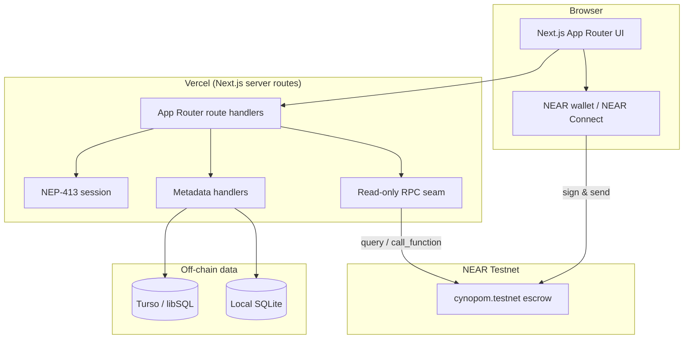

# GatherBond — System Documentation

**Version:** Testnet v1 · **Last updated:** 2026-11-11 · **Network:** NEAR Testnet only

GatherBond is a commitment-first event platform. Organizers create events with a refundable native NEAR deposit; attendees reserve with the exact deposit and receive a one-time ticket; the organizer checks attendees in; after the event the contract settles refunds and the no-show pool deterministically.

This document is the single place to understand how the system is built and operated. For a quick start, read [`../README.md`](../README.md). For the contract deployment sequence, read [`DEPLOY_RUNBOOK.md`](./DEPLOY_RUNBOOK.md). For the metadata API in depth, read [`METADATA.md`](./METADATA.md).

---

## Table of contents

1. [Product model](#product-model)
2. [System architecture](#system-architecture)
3. [Smart contract](#smart-contract)
4. [Metadata layer](#metadata-layer)
5. [Authentication](#authentication)
6. [HTTP API](#http-api)
7. [Frontend](#frontend)
8. [Data model](#data-model)
9. [Local development](#local-development)
10. [Testing and verification](#testing-and-verification)
11. [Deployment and operations](#deployment-and-operations)
12. [Security model](#security-model)
13. [Troubleshooting](#troubleshooting)
14. [Known limitations](#known-limitations)
15. [Documentation maintenance](#documentation-maintenance)

---

## Product model

### The problem

Free registrations are weak commitments. No-shows waste capacity, venue spend, food and the chance for someone else to attend. Conventional registration tools record intent but do not make the commitment financially real.

### The mechanic

- The organizer chooses a refundable deposit per event.
- The attendee locks the exact deposit in the escrow contract.
- A one-time ticket proves the right to be checked in; the secret never goes on chain.
- The organizer authorizes attendance inside the check-in window.
- After the event ends, anyone may finalize. The contract snapshots attendance and computes the per-attendee reward from the no-show deposits.
- Checked-in attendees claim deposit + reward. No-shows claim nothing. A cancelled event refunds the full deposit.

### Product decisions

| Decision | Choice |
| --- | --- |
| Network | NEAR Testnet only |
| Asset | Native NEAR |
| Custody | One escrow contract, no platform balance |
| Deposit | Organizer chooses per event |
| Attendance | On-chain boolean per reservation; no NFT |
| Finalization | Permissionless after `end_at` |
| Claims | Individual pull claims with async transfer callbacks |
| Platform cut | Zero in the MVP |
| Metadata | Off-chain descriptive JSON + SHA-256; never financial truth |
| Hosting | Vercel frontend; Turso metadata; NEAR RPC |

---

## System architecture



### Trust boundaries

- The **contract** is authoritative for all money and attendance.
- The **metadata database** stores only descriptive data and cannot alter settlement.
- The **server** authenticates wallet sessions but never signs user transactions.
- The **browser** holds the ticket secret and wallet signature; neither is stored server-side.
- The **organizer** authorizes check-in in this MVP. This is a disclosed trust assumption, not a trustless claim.

---

## Smart contract

Source: [`contracts/src/lib.rs`](../contracts/src/lib.rs). Deployed as one contract, `gatherbond-escrow`.

### Lifecycle methods

| Method | Caller | Deposit | Notes |
| --- | --- | --- | --- |
| `new(treasury, network_id)` | deployer | any | Immutable treasury and network identity; binds ticket commitments to the network |
| `fund_reserve()` | anyone | any | Tops up the storage reserve |
| `create_event(...)` | organizer | ≥ 0.01 NEAR | Immutable deposit, capacity, schedule and `metadata_hash` |
| `register(event_id, ticket_commitment)` | attendee | exact deposit | One reservation per account; measures real storage growth |
| `check_in(event_id, attendee, secret)` | organizer | 0 | Verifies the SHA-256 commitment inside the check-in window |
| `rotate_ticket_commitment(event_id, commitment)` | attendee | 0 | Replaces a lost ticket; old code is invalid immediately |
| `cancel_event(event_id)` | organizer | 0 | Only before `start_at`; full refunds afterwards |
| `finalize_event(event_id)` | anyone | 0 | Only after `end_at`; snapshots attendance and reward |
| `claim_settlement(event_id)` | attendee | 0 | Pull claim with a per-event single-flight lock |
| `withdraw_treasury(amount)` | treasury | 0 | Bounded by accrued treasury |

### Views

`get_event`, `get_events`, `get_event_count`, `get_reservation`, `get_reservations_for_account`, `get_attendance_history`, `get_treasury_balance`, `get_total_liability`, `get_pending_amount`, `get_storage_stake`, `get_required_balance`, `get_surplus`, `get_last_storage_delta`, `get_max_record_bytes`, `get_treasury_account`, `get_network_id`.

Listing and history views are bounded (`MAX_PAGE = 20`); capacity is capped at `MAX_CAPACITY = 500`.

### Timing rules

```text
now < registration_deadline <= start_at < end_at
registration_deadline <= checkin_open < checkin_close <= end_at
```

Check-in may open before the event starts once registration has closed. Finalization requires `now >= end_at`. Cancellation requires `now < start_at`.

### Accounting invariant

Every liability is counted exactly once:

```text
total_liability = Σ_event(refund_pool + reward_pool) + treasury_accrued
pending_total   = Σ in-flight payout amounts
storage_stake   = env::storage_usage() × env::storage_byte_cost()
buffer          = max(0.001 NEAR, storage_stake / 20)

balance >= total_liability + pending_total + storage_stake + buffer
```

The invariant is checked whenever a state change can affect it. Moving an amount from a pool into `pending_total` keeps the sum constant, so the check at initiation is also the proof that the transfer receipt cannot fail for lack of balance. Payouts are single-flight per event, plus one global treasury lock; callbacks perform local accounting and restore entitlements if a transfer fails.

### Storage policy

Storage growth is paid from funded surplus, never from refundable deposits. `create_event` requires a disclosed non-refundable contribution (minimum 0.01 NEAR) that covers the measured event record and the reserve buffer. `register` admits a reservation only when the pre-existing surplus covers the measured `storage_usage()` delta. No byte-per-attendee estimate is used for admission.

### Ticket commitment

```text
SHA256(
  "GatherBond:v1" ||
  u32le(len(network_id))   || network_id ||
  u32le(len(contract_id))  || contract_id ||
  event_id_le_u64 ||
  u32le(len(attendee))     || attendee ||
  u32le(len(secret))       || secret
)
```

Known-answer vectors: [`ticket-commitment-vectors.json`](./ticket-commitment-vectors.json). The Rust helper and the TypeScript implementation are checked against the same vectors by `scripts/verify-ticket-commitment.mjs`.

### Economic examples

- 3 registered, 2 checked in, 1 NEAR deposit: reward pool = 1 NEAR, reward per attendee = 0.5 NEAR, each attendee receives 1.5 NEAR.
- 3 registered, 0 checked in: reward = 0; the whole pool accrues to treasury as the contract-defined remainder.
- Cancelled event: every registered attendee claims exactly the deposit back.

---

## Metadata layer

The metadata layer makes events discoverable without putting large descriptive content in contract state. It is optional: without a database the escrow contract remains fully usable and metadata routes fail closed with `503`.

### Canonical document

`server/metadata/canonical.mjs` defines the document. Required fields (except `schema_version`, `image_url`, `tags`):

| Field | Limit |
| --- | --- |
| `schema_version` | must be `1` |
| `network_id` | 32 bytes |
| `contract_id` | NEAR account id; must match the event key |
| `organizer_account_id` | NEAR account id; must match the creator |
| `title` | 140 bytes, non-empty |
| `description` | 4000 bytes |
| `category` | 40 bytes, non-empty |
| `venue` | 200 bytes |
| `image_url` | 500 bytes, `https://` or empty |
| `tags` | ≤ 8 entries, 32 bytes each |
| `created_at` | RFC 3339 UTC |

Canonicalization sorts keys recursively, stringifies with no whitespace, keeps UTF-8 bytes as provided and SHA-256s the result. Financial fields (`deposit`, `capacity`, `status`, timestamps) are rejected. `event_id` is excluded because the contract assigns it inside `create_event`; binding comes from the unique `(network_id, contract_id, event_id)` row plus the create transaction hash.

Known-answer vectors: [`metadata-vectors.json`](./metadata-vectors.json).

### Database

Migration: [`database/migrations/0001_event_metadata.sql`](../database/migrations/0001_event_metadata.sql).

- `event_metadata` — identity `(network_id, contract_id, event_id)`; canonical JSON, digest, denormalized display columns, publication status.
- `event_publications` — append-only publish/unpublish log. The highest version is authoritative; unpublish is a tombstone, not a delete.
- `event_id` is stored as `TEXT` decimal u64 so values above 2^53 survive.

Production uses Turso/libSQL through `server/metadata/libsql.mjs`; local development and tests use Node's `node:sqlite` through `server/metadata/sqlite.mjs`. The adapter is dependency-injected, so tests never need a token.

### Runtime selection

| Configuration | Mode | Behaviour |
| --- | --- | --- |
| `TURSO_DATABASE_URL` + `TURSO_AUTH_TOKEN` | `turso` | Production metadata store; migrations applied explicitly |
| `METADATA_SQLITE_PATH` | `sqlite` | Local SQLite; migration applied automatically |
| neither | `unavailable` | Metadata routes return `503`; escrow stays usable |

See [`METADATA.md`](./METADATA.md) for the full API and publication semantics.

---

## Authentication

Wallet sessions use NEP-413 message signing. Source: [`server/auth/`](../server/auth).

1. The browser connects with `@hot-labs/near-connect` (no function-call key) and asks the wallet to sign the GatherBond login message with a random 32-byte nonce.
2. `POST /api/auth/session` verifies the Ed25519 signature over the domain-separated message, checks `view_access_key(account, public_key)` through read-only RPC, and consumes the single-use nonce.
3. On success the server sets an HttpOnly `gatherbond_session` cookie: `v1.<base64url(payload)>.<base64url(HMAC-SHA256(payload))>`.
4. Metadata writes derive the actor from the verified cookie. There is no client-supplied actor in production.

Properties:

- The session secret must be at least 32 characters. Without it, login returns `503` and writes stay `401`.
- Cookies are `HttpOnly`, `SameSite=Lax`, `Path=/`, and `Secure` when `GATHERBOND_SECURE_COOKIES=1`.
- Nonces are single-use per account and persisted in `auth_nonces`.
- Login and writes use a process-local fixed-window rate limiter and return `429` with `Retry-After` when exceeded. The limiter runs before signature verification, RPC lookup or nonce consumption.
- `GATHERBOND_ALLOW_DEV_ACTOR=1` + `x-gatherbond-actor` is a local-only seam and must never be set in a deployed environment.

---

## HTTP API

All JSON responses are `no-store`. Metadata routes are thin wrappers around framework-agnostic handlers in `server/http/routes.mjs`.

| Method | Route | Auth | Summary |
| --- | --- | --- | --- |
| `GET` | `/api/config` | public | `{ network_id, contract_id, contract_configured }` |
| `GET` | `/api/health` | public | Database mode/reason, auth configured, contract configured, `database_read` |
| `GET` | `/api/contract/event-count` | public | On-chain `{ count }` |
| `GET` | `/api/events?limit&offset&category` | public | Published verified listings; bounded `limit ≤ 50` |
| `GET` | `/api/events/:id` | public | Verified publication + read-only on-chain terms |
| `GET` | `/api/events/:id/publication` | public | Current published snapshot |
| `GET` | `/api/events/:id/metadata` | public | Draft/verification read used by the organizer flow |
| `PUT` | `/api/events/:id/metadata` | organizer session | Save/replace the draft; idempotent retry |
| `POST` | `/api/events/:id/publication` | organizer session | Publish the current draft |
| `DELETE` | `/api/events/:id/publication` | organizer session | Append an unpublish tombstone |
| `POST` | `/api/auth/session` | public | NEP-413 login; sets the session cookie |
| `GET` | `/api/auth/session` | cookie | Current session or `401` + auth config |
| `DELETE` | `/api/auth/session` | cookie | Clears the session cookie |
| `GET` | `/api/me/commitments` | wallet session | Reservations + on-chain event state for the signed-in account |

### Status semantics

| Status | Meaning |
| --- | --- |
| `200` / `201` | Success (idempotent retry returns the existing version) |
| `400` | Invalid body, key or metadata (including financial fields) |
| `401` / `403` | Missing session / actor is not the organizer |
| `404` | Event or draft not found / not published |
| `409` | Hash mismatch or conflicting publication |
| `429` | Rate limited; `Retry-After` included |
| `503` | RPC, database or auth configuration unavailable; fails closed |

The `GET /api/events/:id` response returns metadata only when the stored JSON re-hashes to its stored digest **and** matches the on-chain `metadata_hash`; otherwise it returns `409 metadata_hash_mismatch` and never presents altered content as verified.

---

## Frontend

Source: [`frontend/`](../frontend). Next.js App Router with React 19 and a plain CSS design system.

### Routes

| Route | Purpose |
| --- | --- |
| `/` | Marketing hero, verified discovery, mechanic, organizer CTA |
| `/events/[id]` | Event passport: verified metadata, on-chain terms, reserve, Flake Fund, passport |
| `/events/[id]/recap` | Public recap: contract counts, flake fund, integrity proof |
| `/studio` | Organizer studio: create/load, draft, publish/unpublish, proof dashboard, check-in |
| `/commitments` | Attendee commitments: reservations, tickets, recovery, claims, receipts |
| `/_not-found` | Honest empty state |

### Client libraries

- `lib/contract.js` — integer NEAR formatting, schedule validation, ticket encode/decode, browser ticket storage.
- `lib/ticketCommitment.mjs` — SHA-256 ticket commitment matching the Rust contract.
- `lib/nearWallet.js` — lazy NEAR Connect bridge; connects without a function-call key and signs/sends contract calls.
- `lib/walletLogin.mjs` — NEP-413 message and login body.
- `lib/events.js` / `lib/flakeFund.js` — display mapping and Flake Fund math.

### QR and Gate Mode

The ticket card renders the one-time `GB1.` code as a QR with a downloadable PNG and copyable fallback. Gate Mode opens the camera, uses `BarcodeDetector` with a `jsqr` fallback, auto-submits a decoded ticket and keeps manual paste available. The QR is transport only; the check-in transaction is still on chain.

### Design system — Nocturne

- **Palette:** bone/paper surfaces, ink text, ember orange, cobalt blue, marigold and green accents.
- **Type:** Instrument Sans (UI) and Instrument Serif (display), self-hosted with OFL licenses.
- **Layout:** sharp editorial grid, compact 68px header, compact three-column footer.
- **Motion:** hero entry, ticker, floating pass card and hover lifts. No JS scroll-reveal layer and no animation that hides content; `prefers-reduced-motion` collapses every animation to its final state.
- **CSS order:** `globals.css` → `flow.css` → `nocturne.css`. Legacy styles remain as a compatibility layer; Nocturne loads last and owns the final look.

Responsive breakpoints were verified at 390, 768, 1024 and 1440 px: zero horizontal overflow, no text outside its viewport, all headings visible, filter rows wrap on tablet/phone and sticky passport/recap panels stop before the footer.

---

## Data model

### On-chain

- `Event` — organizer, metadata hash, deposit, capacity, counts, schedule, status, refund pool, reward pool, reward per attendee, payout lock.
- `Reservation` — event id, attendee, deposit, ticket commitment, checked-in flag/time, claim status.
- Global accounting — `total_liability`, `pending_total`, `treasury_accrued`, treasury lock, measured storage deltas.

### Off-chain

- `event_metadata` — display columns + canonical JSON + digest + publication status.
- `event_publications` — append-only version history for publish/unpublish.
- `auth_nonces` — single-use login nonces.

The on-chain identity `(network_id, contract_id, event_id)` binds the two stores. The metadata layer never owns money or attendance.

---

## Local development

### Prerequisites

- Node.js 20+ and npm
- Rust with `wasm32-unknown-unknown` for contract work
- On Windows, Visual Studio CMake on `PATH` and `AWS_LC_SYS_PREBUILT_NASM=1`

### Frontend

```bash
cd frontend
npm install
cp ../.env.example .env.local
npm run dev
```

Minimum useful local config:

```bash
NEXT_PUBLIC_NEAR_NETWORK_ID=testnet
NEXT_PUBLIC_NEAR_NODE_URL=https://rpc.testnet.near.org
NEXT_PUBLIC_CONTRACT_NAME=cynopom.testnet
CONTRACT_NAME=cynopom.testnet
METADATA_SQLITE_PATH=.data/gatherbond.sqlite
GATHERBOND_SESSION_SECRET=<at least 32 characters>
GATHERBOND_AUTH_RECIPIENT=gatherbond.app
```

Without a session secret, login is disabled and metadata writes return `401`. Without a database, metadata routes return `503` and the escrow UI still works.

### Contract

```bash
cd contracts
cargo fmt --check
cargo test --offline
bash ../scripts/deploy-contract.sh
```

`scripts/deploy-contract.sh` builds the release WASM, prints its size and SHA-256, computes the storage stake, verifies every required method and init signature, and prints the near-cli-rs deploy command. It never deploys.

### Metadata vectors

```bash
python scripts/generate_metadata_vectors.py
python scripts/generate_ticket_vectors.py
node scripts/verify-ticket-commitment.mjs
```

---

## Testing and verification

```bash
bash scripts/verify-local.sh
npm run build --prefix frontend
```

`verify-local.sh` runs six steps:

1. `cargo fmt --check`
2. `cargo test --offline` with a warnings-as-failure check
3. ticket-commitment parity between Rust and TypeScript
4. Flake Fund + contract display/schedule math + QR round-trip tests
5. metadata + auth + publication + HTTP tests, including the live Next app over a temporary SQLite database
6. print-only deploy handover

Latest verified result:

```text
50 contract tests
8/8 ticket-commitment vectors
37 Flake Fund + contract display/schedule math + QR round-trip tests
94 Node metadata/auth/HTTP tests
production Next build: /events/[id]/recap present
deploy handover: 17 required methods, 414,933-byte WASM
```

The HTTP end-to-end test covers draft save/retry, auth failures, hash mismatches, published-only listings, versioned publish/republish/unpublish, cross-account rejection and rate limiting. Session tests cover NEP-413 byte vectors, Ed25519 verification, expiry/tampering, nonce replay and full-access-key enforcement.

---

## Deployment and operations

### Frontend — Vercel

The production app is <https://gatherbond.vercel.app>, deployed from `main` through Vercel's Git integration. The Next.js app lives in `frontend/`.

Production environment variables:

| Variable | Value / note |
| --- | --- |
| `NEXT_PUBLIC_NEAR_NETWORK_ID` | `testnet` |
| `NEXT_PUBLIC_NEAR_NODE_URL` | `https://rpc.testnet.near.org` |
| `NEXT_PUBLIC_CONTRACT_NAME` | `cynopom.testnet` |
| `CONTRACT_NAME` | `cynopom.testnet` |
| `NEAR_RPC_URL` | `https://rpc.testnet.near.org` |
| `TURSO_DATABASE_URL` | Turso URL (server-only) |
| `TURSO_AUTH_TOKEN` | Turso token (server-only) |
| `GATHERBOND_SESSION_SECRET` | 32+ random characters |
| `GATHERBOND_AUTH_RECIPIENT` | `gatherbond.app` |
| `GATHERBOND_SECURE_COOKIES` | `1` |
| `GATHERBOND_SESSION_TTL_SECONDS` | `7200` (optional) |
| Rate-limit variables | defaults are safe; see `.env.example` |

Do not set `GATHERBOND_RATE_LIMIT_DISABLED` or `GATHERBOND_ALLOW_DEV_ACTOR` in production.

### Metadata database

Apply `database/migrations/0001_event_metadata.sql` to the Turso database once. Local SQLite applies the same schema automatically. The live `/api/health` reports `database_mode: "turso"` and `database_read: "ok"`.

### Contract

The live contract is `cynopom.testnet`. See [`DEPLOY_RUNBOOK.md`](./DEPLOY_RUNBOOK.md) for build, deploy, upgrade and acceptance commands. Contract deployment is human-gated: it requires a funded Testnet account and a signature.

### Release checklist

1. `bash scripts/verify-local.sh`
2. `npm run build --prefix frontend`
3. Review `git diff` for secrets and generated artifacts
4. Commit and push to `main`
5. Wait for the Vercel production deployment
6. Check `/api/health`, `/api/config`, `/api/contract/event-count`
7. Load `/`, `/events/0`, `/events/0/recap`, `/studio`, `/commitments` on the live origin
8. Record the release in [`../BUILD_LOG.md`](../BUILD_LOG.md)

---

## Security model

### Protections

- NEP-413 signature verification with a domain-separated message.
- Full-access-key enforcement through read-only RPC.
- Single-use nonces persisted server-side.
- HttpOnly HMAC session cookies; no token in browser storage.
- Server-derived actor for every metadata write; organizer ownership checked against the canonical document.
- Process-local rate limits on login and writes.
- Canonical hash re-check on read and write; altered metadata is never shown as verified.
- Contract-level solvency invariant, per-event payout locks and failed-transfer recovery.
- No server signing key; every user transaction is wallet-signed.

### Disclosed assumptions

- The organizer authorizes check-in in this MVP. A malicious organizer can deny or falsify attendance, subject to the public event rules.
- Testnet-only; no mainnet funds and no audit.
- Rate limiting is process-local, so separate replicas each enforce their own counters.
- Turso availability affects discovery and metadata writes, never escrow.
- The metadata database operator could withhold listings, but cannot change money or attendance.

### Reporting

See [`../SECURITY.md`](../SECURITY.md). Do not open a public issue for a vulnerability. This is a testnet project; report privately to the repository maintainer.

---

## Troubleshooting

| Symptom | Likely cause | Fix |
| --- | --- | --- |
| `503 metadata_store_unavailable` | No database configured or database unreachable | Set `TURSO_*` in production or `METADATA_SQLITE_PATH` locally |
| `401 unauthorized` on publish | No session or session secret unset | Sign in with a wallet; set `GATHERBOND_SESSION_SECRET` |
| `403` on publish | Signed-in account is not the organizer | Connect the organizer wallet that created the event |
| `409 metadata_hash_mismatch` | Stored JSON no longer matches the digest/on-chain hash | Do not trust the listing; re-publish from the correct draft |
| `429` | Rate limit exceeded | Wait for `Retry-After`; tune the documented limits if needed |
| `contract_not_configured` | `CONTRACT_NAME` / `NEXT_PUBLIC_CONTRACT_NAME` missing | Set the contract account |
| Reserve disabled | No wallet, wrong network or missing contract | Connect a Testnet wallet and check `/api/config` |
| Check-in rejected | Outside the window, wrong secret, already used, or not organizer | Check event timing and ticket state in the studio |
| Claim unavailable | Event not finalized, not checked in, or already claimed | Read the event and reservation state from the contract |

---

## Known limitations

- One funded single-account Testnet acceptance run is recorded; a multi-account published pilot is still open.
- The camera path was verified through the active pipeline with a fixture, not a physical printed QR.
- No contract audit; no mainnet procedure.
- Process-local rate limits and nonces are not shared across replicas.
- Metadata is optional and discovery is honest but empty when no verified publication exists.
- No open-source license has been selected yet.

## Documentation maintenance

- Update `README.md` for anything a new user or judge needs first.
- Update this file when architecture, APIs, env vars or security boundaries change.
- Update `DEPLOY_RUNBOOK.md` whenever the contract or release procedure changes.
- Append only verified facts to `BUILD_LOG.md`.
- Keep `HACKATHON.md` unchanged; it is the organizer-provided source.
- Never put credentials, tokens or private keys in documentation.
