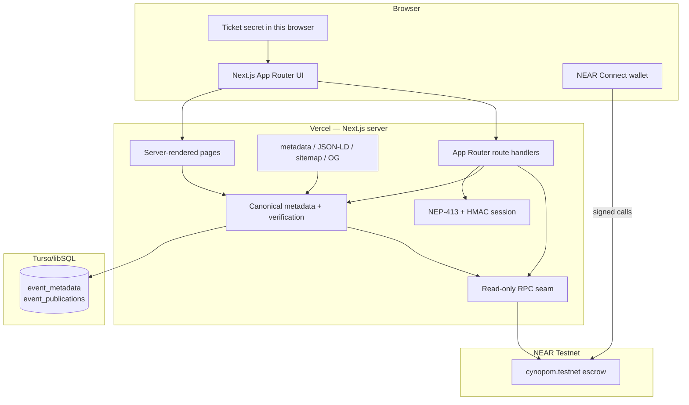

# GatherBond — System Documentation

**Version:** Testnet v1.1 · **Last updated:** 2026-11-13 · **Network:** NEAR Testnet only
**Contract:** `cynopom.testnet` · **Production app:** <https://gatherbond.vercel.app>

GatherBond is a commitment-first event platform. Organizers create real-world rooms with a refundable native NEAR deposit. Attendees reserve with the exact deposit and receive a one-time ticket. The organizer checks them in at the door. After the room ends, the first attendee claim settles the event automatically: checked-in attendees reclaim their bond and split the no-show pool; no-shows forfeit theirs.

This document is the single authoritative description of the system as implemented. For a quick start, read [../README.md](../README.md). For deployment, read [DEPLOY_RUNBOOK.md](./DEPLOY_RUNBOOK.md). For the metadata API, read [METADATA.md](./METADATA.md). For crawlability, read [SEO.md](./SEO.md).

---

## Table of contents

1. [Product model](#1-product-model)
2. [System architecture](#2-system-architecture)
3. [Smart contract](#3-smart-contract)
4. [Metadata layer](#4-metadata-layer)
5. [Authentication](#5-authentication)
6. [HTTP API](#6-http-api)
7. [Frontend and SEO](#7-frontend-and-seo)
8. [Data model](#8-data-model)
9. [Local development](#9-local-development)
10. [Testing and verification](#10-testing-and-verification)
11. [Deployment and operations](#11-deployment-and-operations)
12. [Security model](#12-security-model)
13. [Troubleshooting](#13-troubleshooting)
14. [Known limitations](#14-known-limitations)
15. [Documentation maintenance](#15-documentation-maintenance)
16. [Glossary](#16-glossary)

---

## 1. Product model

### 1.1 The problem

Free registration records intent, not commitment. No-shows waste venue capacity, food, planning effort and the chance for someone else to attend. Conventional tools cannot make attendance financially meaningful, and their refund rules are usually prose rather than executable rules.

### 1.2 The product

- The organizer chooses a refundable deposit per event and creates immutable timing rules.
- The attendee locks the exact deposit in a native NEAR escrow contract and commits to a one-time ticket.
- The organizer checks attendees in inside the published window.
- Settlement is deterministic: at or above 20% attendance, attendees get their deposit plus an equal share of the no-show pool; below 20%, everyone gets their deposit back and no pool is distributed.
- Claims are individual pull withdrawals. The first claim on an ended `Open` event settles it automatically.
- The metadata database stores display copy only. It can never change money or attendance.

### 1.3 Actors

| Actor | Can do | Cannot do |
| --- | --- | --- |
| Organizer | create an event, cancel before start, check attendees in, publish metadata | change the deposit after creation, check in after the window, touch attendee funds |
| Attendee | reserve, rotate a lost ticket, claim settlement | check themselves in, claim without attendance unless the room failed the floor |
| Anyone | read public events, reservations and proof; call `finalize_event` for tooling | move funds without an entitlement |
| Treasury account | withdraw accrued rounding remainder | touch refund or reward pools |
| Metadata operator | withhold or publish display metadata | alter deposits, capacity, attendance, claims or settlement |
| Server | verify sessions, hashes and RPC state; serve HTML/JSON | sign user transactions, hold user funds |

### 1.4 Product decisions

| Decision | Choice | Why |
| --- | --- | --- |
| Network | NEAR Testnet only | No audit or mainnet procedure |
| Asset | Native NEAR | No wrapped token or platform balance |
| Custody | One escrow contract | One auditable liability pool |
| Deposit | Chosen by organizer, exact at registration | No partial commitments |
| Attendance | On-chain boolean per reservation | Auditable without an NFT |
| Settlement | Automatic on first claim after end | No admin step, no organizer finalize UI |
| Claims | Individual pull transfers | One failed transfer cannot block the room |
| Platform cut | Zero | The product does not take a deposit or no-show cut |
| Metadata | Off-chain canonical JSON + SHA-256 | Cheap display data, contract-anchored |
| Publication | Append-only, permanent | No silent disappearance; no unpublish UI |
| Discovery | Verified-only | An unverified row is never shown |
| Hosting | Vercel + Turso | Serverless Next.js and a managed SQLite-compatible store |

---

## 2. System architecture



### 2.1 Request paths

| Flow | Path |
| --- | --- |
| Browse home | server component → `loadPublishedListings()` → metadata runtime → Turso + `get_event` → HTML + JSON-LD |
| Open event | server component → `loadPublishedEvent()` → publication + local hash + RPC hash → HTML + Event JSON-LD |
| Reserve | browser → wallet `register(event_id, commitment)` with exact deposit → NEAR |
| Check in | organizer browser → wallet `check_in(event_id, attendee, secret)` → NEAR |
| Claim | browser → wallet `claim_settlement(event_id)` → contract auto-settles if needed → transfer + callback |
| Publish | browser → `POST /api/events/:id/publication` → session actor → metadata store append |
| Discover | public API or server-loaded initial shelf; only verified rows |
| Recap | server-loaded event → client proof view with contract counters |

### 2.2 Trust boundaries

| Layer | Authoritative for | Never authoritative for |
| --- | --- | --- |
| NEAR contract | deposits, capacity, registration, attendance, cancellation, settlement, rewards, claims, treasury | display copy, images |
| Metadata database | title, description, category, venue, image URL, tags, publication history | money, attendance, eligibility |
| Server | sessions, canonical hashing, RPC verification, HTTP/HTML | user funds, user signatures |
| Organizer | door check-in in this MVP | changing terms after creation or rewriting attendance |
| Browser | ticket secret and wallet interaction | another user's ticket or balance |

The metadata operator can withhold a listing. It cannot make anyone paid, checked in, refundable or settled.

### 2.3 Deployment topology

- **Vercel** runs the Next.js app and route handlers on Node.js.
- **Turso/libSQL** holds the metadata and publication log.
- **NEAR Testnet RPC** is read through a narrow read-only client.
- The **contract** is a separate Testnet account; the frontend has no signing key.
- The app root is `frontend/`; the framework-agnostic server modules live at the repository root and are traced into the server bundle.

---

## 3. Smart contract

### 3.1 Identity and artifact

| Item | Value |
| --- | --- |
| Account | `cynopom.testnet` |
| Network | `testnet` |
| WASM size | 415,893 bytes |
| WASM SHA-256 | `af6b8bbc13c9ec589345a50df62ab73183033d5ad15b71da1deff96e4691da4b` |
| Source | `contracts/src/lib.rs` |
| Tests | 54 passing |
| Init | `new(treasury: AccountId, network_id: String)` |
| Deploy handover | 17 required methods checked |

The contract is compiled with `panic = "abort"` in release. A rejected call therefore surfaces as a WASM trap without a human-readable message. The UI validates schedules before signing; the runbook documents the limitation.

### 3.2 State

```rust
EventStatus = Open | Cancelled | Finalized
ClaimStatus = Unclaimed | Pending | Claimed

Event {
  organizer, metadata_hash, deposit, capacity,
  registered, checked_in,
  start_at, end_at, registration_deadline,
  checkin_open, checkin_close,
  status, refund_pool, reward_pool, reward_per_attendee,
  lock, lock_nonce, lock_amount
}

Reservation {
  event_id, attendee, deposit, ticket_commitment,
  checked_in, checked_in_at, claim
}
```

There is **no `Failed` contract status**. A room that misses the 20% floor becomes `Finalized` with `refund_pool = registered × deposit`, `reward_pool = 0` and `reward_per_attendee = 0`. The UI's “failed” language is a presentation of that state.

An ended `Open` event is a UI-only settlement-pending state. The contract remains `Open` until `claim_settlement` or `finalize_event` calls the settlement logic.

### 3.3 Methods

| Method | Access | Behavior |
| --- | --- | --- |
| `new(treasury, network_id)` | init | Sets the treasury and network identity; attached deposit seeds the storage reserve |
| `fund_reserve()` | anyone, payable | Logs a storage contribution; no accounting liability |
| `create_event(...)` | organizer, payable | Creates immutable terms; requires ≥0.01 NEAR non-refundable storage contribution; anchors 32-byte metadata hash |
| `register(event_id, ticket_commitment)` | attendee, payable | Requires exact deposit, `Open`, before deadline, capacity available, no duplicate, not locked |
| `check_in(event_id, attendee, secret)` | organizer | Requires `Open`, inside inclusive check-in window, not locked, unused ticket, matching commitment |
| `rotate_ticket_commitment(event_id, commitment)` | reservation owner | Before check-in closes; invalidates the old ticket; no financial change |
| `cancel_event(event_id)` | organizer | Before start, `Open`, not locked; full refunds |
| `finalize_event(event_id)` | anyone | After end, `Open`, not locked; snapshots pools/status |
| `claim_settlement(event_id)` | attendee, ≥30 Tgas | Auto-settles an ended `Open` event, then pays the caller's entitlement with a 15 Tgas callback |
| `withdraw_treasury(amount)` | treasury | Withdraws only accrued remainder; global treasury lock |
| `get_event`, `get_events`, `get_event_count` | view | Public event data; page size capped at 20 |
| `get_reservation`, `get_reservations_for_account`, `get_attendance_history` | view | Bounded public reservation/attendance views |
| `get_treasury_balance`, `get_total_liability`, `get_pending_amount`, `get_storage_stake`, `get_required_balance`, `get_surplus`, `get_last_storage_delta`, `get_max_record_bytes`, `get_treasury_account`, `get_network_id` | view | Solvency, storage and identity observability |

`on_claim_callback` and `on_treasury_callback` are private callbacks, not user entry points.

### 3.4 Timing rules

`create_event` enforces:

```text
now < start_at
start_at < end_at
registration_deadline > now
registration_deadline <= start_at
checkin_open >= registration_deadline
checkin_open < checkin_close
checkin_close <= end_at
```

The studio form exposes one date, start/end times, a registration deadline and a check-in window. It validates the same orderings before a wallet signature. The default is start + 3 hours, two hours long; registration 2 hours before start; check-in opens 30 minutes before start and closes at the end. These are defaults, not contract rules.

### 3.5 Economics

Let:

- `D` = deposit per reservation
- `N` = registered reservations
- `K` = checked-in reservations
- `pool = (N - K) × D`
- `reward = floor(pool / K)` when `K > 0`
- `remainder = pool - reward × K`

| Condition | Status after settlement | Refund pool | Reward per attendee | Who can claim |
| --- | --- | --- | --- | --- |
| `N = 0` | `Finalized` | 0 | 0 | nobody |
| `K × 5 < N` (below 20%) | `Finalized` | `N × D` | 0 | every reservation, including no-shows |
| `K × 5 >= N`, `K > 0` | `Finalized` | `K × D` | `floor((N-K)D / K)` | checked-in attendees only |
| `Cancelled` before start | `Cancelled` | `N × D` | 0 | every reservation |

The remainder accrues to `treasury_accrued`. The platform takes no cut. Exactly 20% passes the floor and settles normally.

**Worked example:** 3 reservations at 1 NEAR, 2 checked in. Pool = 1 NEAR; reward = 0.5 NEAR. Each attendee claims 1.5 NEAR. The no-show claims nothing. If only 0 checked in, both pools are 0 and every reservation claims 1 NEAR back.

### 3.6 Accounting invariant

```text
total_liability = Σ_event(refund_pool + reward_pool) + treasury_accrued
pending_total   = Σ in-flight payouts
storage_stake   = env::storage_usage() × storage_byte_cost
buffer          = max(0.001 NEAR, stake / 20)

balance >= total_liability + pending_total + storage_stake + buffer
```

The contract checks solvency whenever a state change can affect it. Registration grows balance and liability by the same deposit; it is admitted only when pre-existing surplus covers the measured storage delta. Storage is never funded from another attendee's refundable deposit.

Payouts are single-flight **per event** plus one global treasury lock. A claim moves the amount from the pools to `pending_total`, checks solvency before scheduling the transfer, and records a nonce. The callback resolves the lock; a failed transfer restores the entitlement. Stale callbacks are logged no-ops.

### 3.7 Ticket commitment

```text
SHA-256(
  "GatherBond:v1"
  || u32le(len(network_id)) || network_id
  || u32le(len(contract_id)) || contract_id
  || u64le(event_id)
  || u32le(len(attendee)) || attendee
  || u32le(len(secret)) || secret
)
```

- The secret is 1–128 bytes on chain; the browser generates a URL-safe random secret.
- The on-chain reservation stores only the 32-byte commitment.
- The secret is never stored on chain, never sent to the metadata API and never placed in a URL.
- Rotating the commitment invalidates the old ticket immediately.
- Rust and JavaScript are checked against 8 known-answer vectors in `docs/ticket-commitment-vectors.json` by `scripts/verify-ticket-commitment.mjs`.

### 3.8 Storage policy

- `MIN_EVENT_STORAGE = 0.01 NEAR` (contract constant). The UI currently attaches 0.1 NEAR by default; both are disclosed as non-refundable.
- `MAX_CAPACITY = 500`.
- `MAX_PAGE = 20` for bounded views.
- The contract measures the actual storage delta on event creation and registration rather than estimating bytes per attendee.
- `buffer = max(0.001 NEAR, storage_stake / 20)`.
- `fund_reserve` accepts extra storage funding but creates no liability.
- The treasury can withdraw only accrued remainder, never attendee pools.

### 3.9 Failure semantics

- `require!` failures abort the transaction; state rolls back.
- Release builds use `panic = "abort"`, so error messages are not surfaced to clients; the UI validates preconditions before signing.
- Contract callbacks never assert the global invariant after funds move; they perform local accounting only.
- A stale or duplicate callback is ignored and does not unlock a newer payout.

---

## 4. Metadata layer

### 4.1 Purpose and boundary

The metadata layer makes a contract event readable and discoverable. It is **not** a source of financial truth. The canonical hash is anchored at `create_event`; every public read verifies both the stored bytes and the on-chain hash.

### 4.2 Canonical document

Required fields:

| Field | Limit | Notes |
| --- | --- | --- |
| `schema_version` | `1` | Current schema |
| `network_id` | 32 bytes | `testnet` |
| `contract_id` | valid account ID | `cynopom.testnet` |
| `organizer_account_id` | valid account ID | Must equal the authenticated actor |
| `title` | 140 bytes | Required, non-blank |
| `description` | 4,000 bytes | May be empty |
| `category` | 40 bytes | Required |
| `venue` | 200 bytes | May be empty |
| `image_url` | 500 bytes | Optional; HTTP(S) only |
| `tags` | 8 × 32 bytes | Optional array |
| `created_at` | 40 bytes | RFC3339 UTC |

Unknown fields, control characters and financial fields are rejected. Canonical JSON sorts object keys recursively and emits no whitespace. The digest is SHA-256 over those UTF-8 bytes.

```json
{
  "category": "Community",
  "contract_id": "cynopom.testnet",
  "created_at": "2026-11-10T05:04:55.231Z",
  "description": "",
  "image_url": "",
  "network_id": "testnet",
  "organizer_account_id": "cynopom.testnet",
  "schema_version": 1,
  "tags": ["supper"],
  "title": "Sunday Table",
  "venue": "Banani Kitchen, Dhaka, Bangladesh"
}
```

### 4.3 Database schema

`event_metadata`:

- Identity: `(network_id, contract_id, event_id)`; `event_id` is `TEXT` so u64 values above 2^53 survive JavaScript.
- Denormalized display columns: title, description, category, venue, image URL, tags JSON.
- Canonical document: `metadata_json`, `metadata_sha256`, `create_tx_hash`.
- `publication_status`: `pending`, `published` or legacy `hidden`.
- `created_at`, `updated_at`.

`event_publications`:

- Append-only versions `(network_id, contract_id, event_id, version)`.
- `action`: `publish` or legacy `unpublish`.
- A publish row carries an immutable metadata snapshot and hash.
- The highest version is current.
- The schema retains legacy tombstone support for databases created before publication became permanent. **Current API and UI do not create unpublish tombstones.** There is no delete or unpublish endpoint.

Migration: `database/migrations/0001_event_metadata.sql`. The migration is loaded lazily when a SQLite/libSQL store is opened; it is not read at Next build time.

### 4.4 Verification matrix

| Check | Where | On failure |
| --- | --- | --- |
| Stored JSON re-hashes to stored digest | `store.verify` | `409 metadata_hash_mismatch` |
| Stored digest equals `get_event().metadata_hash` | handlers | `409`; row hidden from discovery |
| Event still exists on chain | handlers | `409 event_not_found_on_chain` |
| Actor equals `organizer_account_id` | handler authorization | `403 forbidden` |
| Metadata is published, not a draft | `getPublication`, `details` | `404 not_published` |
| Only verified rows appear in list | `handlers.list` | row skipped, `skipped` incremented |

A mismatch never falls back to a cached display copy.

### 4.5 Publication semantics

- `PUT /api/events/:id/metadata` stores/updates the organizer's draft after verifying the hash against the chain.
- `POST /api/events/:id/publication` appends a new published version. If the current publication already has identical content, the operation is an idempotent no-op and returns the existing version.
- `GET /api/events/:id/publication` returns only the current public snapshot; a draft is never returned.
- `GET /api/events/:id` returns the verified publication plus `onchain` terms.
- Publishing is permanent; there is no API to remove a public event.
- Cross-account publish is rejected by the session-derived actor.

Deep API examples: [METADATA.md](./METADATA.md).

### 4.6 Runtime selection

| Environment | Selection |
| --- | --- |
| `TURSO_DATABASE_URL` + `TURSO_AUTH_TOKEN` | Turso/libSQL |
| `METADATA_SQLITE_PATH` | Local Node SQLite |
| neither | Explicit `503 metadata_store_unavailable`; no sample data |

The runtime is lazy. Importing a route or page during a Next build does not require credentials and does not open a database.

---

## 5. Authentication

### 5.1 NEP-413 login flow

1. Browser calls `GET /api/auth/session`.
2. Server returns `{ configured, recipient }` (or `401` with the same public auth metadata).
3. Wallet signs a NEP-413 message for the recipient.
4. Browser posts `{ account_id, public_key, signature, message, nonce, recipient, callback_url? }`.
5. Server checks the message/recipient, verifies the Ed25519 signature over the NEP-413 digest, checks `view_access_key(account, public_key)` is a full-access key, and claims the nonce once.
6. Server issues an HMAC-signed session cookie and returns the account ID and expiry.

The signed digest:

```text
sha256( u32le(2^31 + 413) || borsh({ message, nonce[32], recipient, callbackUrl? }) )
```

The account ID is not part of the signed bytes; ownership is proven by the on-chain access-key check.

### 5.2 Nonces

- 32 random bytes, base64 in transit.
- Scoped to the account.
- Single-use, persisted in the metadata store.
- Concurrent logins with the same nonce have exactly one winner.
- If the nonce store is unavailable, login fails `503`; no session is issued.

### 5.3 Session cookie

- HMAC-SHA256 over account ID, expiry and a version tag.
- `HttpOnly`, `SameSite=Lax`, `Path=/`.
- `Secure` when `GATHERBOND_SECURE_COOKIES=1` (required in production).
- Default TTL 7,200 seconds.
- Missing/short secret disables login with `503`; metadata writes remain `401`.
- The cookie is the only actor source for writes. The client cannot submit an arbitrary actor.

### 5.4 Authorization

- Metadata write: authenticated actor must equal the canonical document's `organizer_account_id`.
- Publish: authenticated actor must equal the stored organizer.
- Commitments: `GET /api/me/commitments` reads reservations for the session account, never a URL parameter.
- The development actor header is ignored unless `GATHERBOND_ALLOW_DEV_ACTOR=1`; never set it in production.

### 5.5 Rate limits

Process-local fixed windows:

- Login per client and per account (default 10 per 60 seconds).
- Metadata writes/publishes per actor (default 30 per 60 seconds).
- Over-limit responses are `429` with `Retry-After` and `retry_after_seconds`.
- Failed signatures, replays and wrong-actor writes count toward the limit.
- State is not shared across server replicas; this is a documented limitation.
- `GATHERBOND_RATE_LIMIT_DISABLED=1` is development/test only.

---

## 6. HTTP API

All JSON responses use `cache-control: no-store` unless a route explicitly opts into caching.

| Route | Methods | Auth | Success | Notes |
| --- | --- | --- | --- | --- |
| `/api/health` | GET | public | 200 | `database_mode`, `database_read`, `auth_configured`, `contract_configured`, `contract_id`, `network_id` |
| `/api/config` | GET | public | 200 | `network_id`, `contract_id`, `contract_configured` |
| `/api/contract/event-count` | GET | public | 200 `{count}` | Live `get_event_count` |
| `/api/events` | GET | public | 200 `{items, skipped, next_offset}` | Verified published rows only; `limit` max 50 |
| `/api/events/[id]` | GET | public | 200 `{verified, event, metadata, onchain, ...}` | 404 unpublished; 409 hash/chain mismatch; 503 unavailable |
| `/api/events/[id]/metadata` | GET | public | 200 verified draft | 404 no draft; 409 mismatch |
| `/api/events/[id]/metadata` | PUT | session | 201 inserted / 200 updated | Body `{metadata, create_tx_hash}`; 401/403/409/503 |
| `/api/events/[id]/publication` | GET | public | 200 current snapshot | 404 not published |
| `/api/events/[id]/publication` | POST | organizer session | 201 new / 200 unchanged | 401/403/409/503 |
| `/api/auth/session` | POST | public | 200 + cookie | NEP-413 login |
| `/api/auth/session` | GET | public | 200 signed in / 401 signed out | Never returns the token |
| `/api/auth/session` | DELETE | public | 204 | Clears the cookie |
| `/api/me/commitments` | GET | session | 200 `{account_id, items}` | Reservations + current on-chain event for the session account |

### 6.1 Error codes

| Code | Meaning |
| --- | --- |
| `invalid_key`, `invalid_body`, `invalid_json` | Request shape rejected before any work |
| `invalid_metadata`, `invalid_metadata_field` | Canonical validation failed |
| `unauthorized` | No session or bad credentials |
| `forbidden` | Session user is not the organizer |
| `metadata_hash_mismatch` | Stored/local/on-chain digest disagreement |
| `event_not_found_on_chain` | Event missing from the configured contract |
| `not_published` | No public snapshot |
| `metadata_store_unavailable` | No database configured or DB unreachable |
| `chain_unavailable` | RPC failure |
| `auth_not_configured`, `auth_unavailable`, `auth_store_unavailable` | Auth dependencies unavailable |
| `invalid_signature`, `unknown_public_key`, `nonce_already_used`, `invalid_recipient` | NEP-413 login failures |
| `contract_not_configured` | Read-only contract identity missing |
| `rate_limit_unavailable` | Limiter could not make a decision |
| `internal_error` | Unhandled server error; no data invented |

A public page or API failure never substitutes local fixtures. `503` is a failure, not a plausible empty state.

---

## 7. Frontend and SEO

### 7.1 Routes

| Route | Type | Rendering | Indexable |
| --- | --- | --- | --- |
| `/` | server page + client filters | Static, 60s ISR; verified shelf server-rendered | Yes |
| `/events/[id]` | server page + client actions | Dynamic server render of verified event | Yes when verified |
| `/events/[id]/recap` | server page + client proof | Dynamic server render | Only after the room closes |
| `/studio` | client app shell | Static | No |
| `/commitments` | client app shell | Static | No |
| `/api/*` | route handlers | Node.js dynamic | No |
| `/robots.txt`, `/sitemap.xml`, `/manifest.webmanifest`, `/icon.svg` | metadata routes | Static/ISR | N/A |
| `/opengraph-image`, `/events/[id]/opengraph-image` | image routes | Static/dynamic | N/A |

### 7.2 Server-rendered data

`frontend/lib/serverEvents.mjs` is the single bridge from server components to the route layer:

- `loadPublishedEvent(id)` calls the same `routes.details()` handler as the public API, with a synthetic internal origin and a `Request`.
- `loadPublishedListings(limit, offset)` calls `routes.list()`.
- `loadAllPublishedListings()` paginates for the sitemap.
- `react.cache` deduplicates the call between `generateMetadata` and the page render in one request.
- Failures return explicit statuses (`invalid`, `not_found`, `conflict`, `unavailable`); they never throw a demo event.
- Event/recap pages call `notFound()` for invalid/unpublished IDs, producing a real 404.
- The home page passes verified listings into `Discover` as initial state, so the event card is in the HTML.
- The sitemap is generated from the same verified loader.

### 7.3 Client state

- `Discover` owns search/category filtering and only fetches if no server initial data was provided.
- `EventDetail` uses `initialEvent` on first render; it fetches only for retry or when the server had no verified data.
- `EventRecap` uses the same pattern.
- `ReservePanel` enforces registration timing and calls the wallet with the exact deposit.
- `CheckIn` handles QR/manual ticket check-in as the organizer.
- `Commitments` reads `/api/me/commitments`, attaches the local ticket if present, and offers claim/recovery.
- `SettlementReceipt`, `FlakeFund` and `RoomProof` render contract-derived state without projecting a final reward before settlement.

### 7.4 SEO implementation

| Concern | Implementation |
| --- | --- |
| Canonical origin | `NEXT_PUBLIC_SITE_URL` through `frontend/lib/site.js`; fallback `https://gatherbond.vercel.app` |
| Root metadata | `frontend/app/layout.js`: metadataBase, template, description, keywords, authors, robots, OpenGraph, Twitter, icons, manifest |
| Home structured data | `Organization` + `WebSite` + verified `ItemList` |
| Event metadata | `generateMetadata` with verified title, factual description, canonical, article OG/Twitter, dynamic image |
| Event structured data | schema.org `Event` with status, dates, place, organizer, contract identifier and the per-event OG image |
| Recap structured data | `WebPage` + `BreadcrumbList`, with the Event as `about` |
| Sitemap | Verified events and closed recaps; 1-hour revalidation; home only on failure |
| Robots | Public allowed; `/api/`, `/studio`, `/commitments` disallowed |
| Noindex | Studio, commitments, open recaps, missing/conflict event metadata, 404 |
| Social images | 1200×630 root and per-event `next/og` cards |
| Escaping | `jsonLdString` escapes `<`, U+2028 and U+2029 |
| Fail closed | No unverified event in metadata, JSON-LD, sitemap or OG card |

Full details and post-deploy checks: [SEO.md](./SEO.md).

### 7.5 QR and Gate Mode

- Tickets encode a `GB1` payload containing event ID, attendee and secret.
- QR rendering uses `qrcode`; scanning uses `jsqr` and the browser camera pipeline.
- The organizer can paste a ticket code if the camera is unavailable.
- A successful check-in is a wallet transaction; the UI does not mark attendance locally first.
- The camera path has been exercised with an active-pipeline fixture, not a physical printed QR in front of a camera.

### 7.6 Design system

The Nocturne system lives in `frontend/app/nocturne.css` and `frontend/app/globals.css`:

- warm paper background, near-black ink, lime and ember accents;
- Instrument Sans / Instrument Serif with local font files;
- editorial grid, ticket/perforation motifs, restrained motion;
- accessible focus states, skip link, target sizes and reduced-motion handling;
- 56 px footer with exactly three icon links (X, email, GitHub).

---

## 8. Data model

### 8.1 On-chain

| Entity | Key | Fields |
| --- | --- | --- |
| Event | `u64` event ID | organizer, metadata hash, deposit, capacity, registered, checked_in, five timestamps, status, pools, reward, lock |
| Reservation | `(event_id, account_id)` | attendee, deposit, ticket commitment, checked_in, checked_in_at, claim |
| Account index | account ID | list of event IDs for bounded history |
| Global | singleton | treasury, network ID, next event ID, total liability, pending amount, treasury accrual/lock/pending, storage metrics |

### 8.2 Off-chain

| Entity | Key | Fields |
| --- | --- | --- |
| Metadata draft | network + contract + event ID | canonical JSON, SHA-256, create tx, status, display columns |
| Publication | event + version | action, immutable JSON snapshot, hash, publisher, timestamp |

### 8.3 Identity rules

- Event identity is `(network_id, contract_id, event_id)`, not an auto-increment database ID.
- Event IDs are text in the database and contract calls use JSON strings for `U64` values.
- Account IDs are validated NEAR account IDs.
- The contract's `metadata_hash` is the join integrity check between layers.

---

## 9. Local development

### 9.1 Prerequisites

- Node.js 22+ (`node:sqlite` is used by local tests).
- npm.
- Rust toolchain + `wasm32-unknown-unknown` for contract work.
- NEAR CLI only for manual Testnet acceptance.
- A NEAR Testnet wallet for wallet flows.

### 9.2 Frontend

```bash
cd frontend
npm install
cp ../.env.example .env.local
# Either set TURSO_DATABASE_URL + TURSO_AUTH_TOKEN,
# or set METADATA_SQLITE_PATH=.data/gatherbond.sqlite for a local DB.
npm run dev
```

Open <http://localhost:3000>.

Without a database:

- `/api/events` and metadata pages return `503 metadata_store_unavailable`.
- The contract is still readable through RPC endpoints and the escrow remains usable.
- No sample event is shown.

The local SQLite adapter applies `database/migrations/0001_event_metadata.sql` automatically when the store opens.

### 9.3 Contract

```bash
cd contracts
cargo fmt --check
cargo test --offline
```

On Windows, add the Visual Studio CMake directory to `PATH` and set `AWS_LC_SYS_PREBUILT_NASM=1` when the toolchain needs them. The verification script does this automatically when the directory exists.

### 9.4 Environment

| Variable | Scope | Required | Default / note |
| --- | --- | --- | --- |
| `NEXT_PUBLIC_NEAR_NETWORK_ID` | public | yes | `testnet` |
| `NEXT_PUBLIC_NEAR_NODE_URL` | public | yes | `https://rpc.testnet.near.org` |
| `NEXT_PUBLIC_CONTRACT_NAME` | public | yes | `cynopom.testnet` |
| `NEXT_PUBLIC_SITE_URL` | public | recommended | canonical origin for metadata/sitemap |
| `CONTRACT_NAME` | server | production | falls back to the public contract |
| `NEAR_RPC_URL` | server | production | read-only verification RPC |
| `TURSO_DATABASE_URL` | server | production | libSQL URL |
| `TURSO_AUTH_TOKEN` | server | production | never expose |
| `METADATA_SQLITE_PATH` | server | local | alternative to Turso |
| `GATHERBOND_SESSION_SECRET` | server | production | ≥32 chars; login disabled if absent |
| `GATHERBOND_AUTH_RECIPIENT` | server/public via session response | recommended | default `gatherbond.app` |
| `GATHERBOND_SESSION_TTL_SECONDS` | server | no | `7200` |
| `GATHERBOND_SECURE_COOKIES` | server | production `1` | HTTPS cookie |
| `GATHERBOND_LOGIN_RATE_LIMIT` | server | no | `10` |
| `GATHERBOND_LOGIN_ACCOUNT_RATE_LIMIT` | server | no | `10` |
| `GATHERBOND_LOGIN_RATE_WINDOW_SECONDS` | server | no | `60` |
| `GATHERBOND_WRITE_RATE_LIMIT` | server | no | `30` |
| `GATHERBOND_WRITE_RATE_WINDOW_SECONDS` | server | no | `60` |
| `GATHERBOND_ALLOW_DEV_ACTOR` | server | dev only | never production |
| `GATHERBOND_RATE_LIMIT_DISABLED` | server | test only | never production |

`.env.example` is the source of truth for comments and rotation guidance.

---

## 10. Testing and verification

### 10.1 Commands

```bash
bash scripts/verify-local.sh
npm run build --prefix frontend
```

`verify-local.sh` is fail-fast and checks compiler warnings. It runs:

1. `cargo fmt --check`
2. `cargo test --offline`
3. ticket-commitment vectors
4. all `frontend/lib/*.test.mjs`
5. all metadata/auth/HTTP/NEAR RPC tests, including a real Next server + SQLite end-to-end flow
6. print-only deploy handover

### 10.2 Latest verified results (2026-11-13)

```text
contract format           clean
contract tests            54 passed
ticket vectors            8/8 matched
frontend tests            75 passed
metadata/auth/HTTP tests  107 passed
total                     236 passed
WASM                      415,893 bytes
SHA-256                   af6b8bbc13c9ec589345a50df62ab73183033d5ad15b71da1deff96e4691da4b
production build          exit 0, 21 routes
```

### 10.3 What the tiers cover

| Tier | Coverage |
| --- | --- |
| Contract (54) | creation validation, deposit/capacity/deadline, ticket check-in, replay, rotation, cancellation, settlement above/below/exactly 20%, no-show refunds, treasury bounds, rounding, locks, callbacks, solvency, storage, pagination, known-answer vectors |
| Frontend (75) | NEAR parsing/formatting, schedule mapping, ticket encoding/QR round-trip, event lifecycle boundaries, claim eligibility, listing/detail mapping, metadata hash display, Flake Fund math, SEO builders, single-flight guard |
| Server (107) | canonical JSON/hash vectors, field rejection, store idempotency/conflicts/races, publication versions, tamper and on-chain mismatch, NEP-413 signatures/nonces/sessions, rate limits, RPC mapping, HTTP end-to-end over a real Next server and SQLite, fail-closed database/RPC paths |
| SEO (10 of 75) | canonical origin, path encoding, description truncation, Event JSON-LD, per-event OG image, cancelled status, graph/ItemList, breadcrumbs, recap graph, script escaping |
| Build | Next metadata routes, dynamic OG cards, server component collection, TypeScript check, 21 routes |

### 10.4 Manual checks actually performed

- Production `/api/health`: `turso`, `database_read: ok`, auth and contract configured.
- Production `/api/contract/event-count`: `8`.
- Production `/api/events?limit=10`: one verified `Sunday Table` row, `skipped: 0`.
- Production `/api/events/0`: verified hash and `Finalized` on-chain terms.
- Local production server: home/event/recap/robots/sitemap/OG `200`; missing event `404`; event HTML contains verified title, canonical, OG image, Event JSON-LD; studio/commitments noindex; sitemap has 3 URLs.

### 10.5 Checks not performed

- No funded multi-account production reserve → check-in → claim run in this session.
- No physical printed QR camera scan.
- No independent contract audit.
- No Search Console/Bing submission or Google rich-results validation.
- No deployment/push of this release candidate.

Do not report a check as passed when it is in this list.

---

## 11. Deployment and operations

### 11.1 Frontend (Vercel)

1. Set the production environment variables (contract, RPC, Turso, session secret, secure cookies, `NEXT_PUBLIC_SITE_URL`).
2. Deploy the repository root with the Vercel project rooted at `frontend/` or configured to run `npm run build --prefix frontend`.
3. The workspace root must be visible to the build so `server/` imports trace correctly.
4. After deploy, run the post-deploy checks in §11.5.

### 11.2 Metadata database

1. Create a Turso database.
2. Apply `database/migrations/0001_event_metadata.sql`.
3. Set `TURSO_DATABASE_URL` and `TURSO_AUTH_TOKEN` as server-only variables.
4. Confirm `/api/health` reports `database_mode: turso` and `database_read: ok`.
5. Never expose the auth token in a `NEXT_PUBLIC_*` variable or client bundle.

### 11.3 Contract

Use [DEPLOY_RUNBOOK.md](./DEPLOY_RUNBOOK.md). The current `cynopom.testnet` signing key is not in this workspace. The runbook verifies the exact artifact hash before deploy and never prints a key.

### 11.4 SEO release checklist

- `NEXT_PUBLIC_SITE_URL` is the production origin (no path, no trailing slash).
- `/robots.txt` references the production sitemap.
- `/sitemap.xml` contains only verified publications.
- A verified event's canonical, OG image and JSON-LD match its actual URL.
- A missing event returns HTTP 404.
- Studio and commitments have `noindex, nofollow`.
- Dynamic OG images return `image/png` at 1200×630.
- Submit the sitemap to Google Search Console and Bing Webmaster Tools.

### 11.5 Post-deploy checks

```bash
curl -sS https://gatherbond.vercel.app/api/health
curl -sS https://gatherbond.vercel.app/api/contract/event-count
curl -sS https://gatherbond.vercel.app/api/events?limit=10
curl -sS -o /dev/null -w '%{http_code}\n' https://gatherbond.vercel.app/events/0
curl -sS -o /dev/null -w '%{http_code}\n' https://gatherbond.vercel.app/events/999999
curl -sS https://gatherbond.vercel.app/robots.txt
curl -sS https://gatherbond.vercel.app/sitemap.xml
curl -sSI https://gatherbond.vercel.app/events/0/opengraph-image
```

Expected: `database_read: ok`; event count is the live chain count; only verified rows; `200`/`404` as above; sitemap has no drafts; OG content type is `image/png`.

### 11.6 Publication lifecycle

```text
create event on chain
  → save draft metadata (PUT)
  → verify draft hash against chain (GET metadata)
  → publish (POST publication; version 1..n)
  → discovery and event page include it
  → event ends; first claim settles
  → recap becomes indexable when closed
```

There is no unpublish. Correct a mistake by publishing a new version; earlier versions remain in history.

### 11.7 Observability

- `/api/health` is the primary readiness probe and never exposes secrets.
- Vercel function logs contain `[gatherbond] metadata store unavailable (<code>)` when selection fails.
- Store errors are converted to `503`; chain errors to `503`; hash mismatches to `409`.
- Contract logs include create/register/check-in/settle/claim events with event IDs and amounts.
- No analytics or APM is wired; this is a hackathon scope decision.

### 11.8 Rollback

- Frontend: redeploy the previous Vercel deployment; the database is backward-compatible.
- Database: migrations are additive (`CREATE TABLE IF NOT EXISTS`); no destructive rollback is documented.
- Contract: upgrades preserve state; do not call `new` on upgrade. There is no automated rollback; the signing key is held by the maintainer.

---

## 12. Security model

### 12.1 Controls

| Threat | Control |
| --- | --- |
| Forged wallet login | NEP-413 Ed25519 verification over the exact digest |
| Key substitution | On-chain `view_access_key` check; account must own the key |
| Replay login | 32-byte single-use nonce scoped to account |
| Session forgery | HMAC-SHA256, HttpOnly, SameSite=Lax, Secure in production |
| Actor spoofing | Actor derived from session; dev header disabled by default |
| Unauthorized metadata write | Actor must equal canonical organizer |
| Metadata tampering | Stored hash + on-chain hash checked on read and write |
| Financial metadata injection | Reject unknown/financial fields in the canonical schema |
| Double claim | `ClaimStatus` + per-event lock + nonce callback |
| Failed payout locking funds | Callback restores entitlement and unlocks |
| Treasury drain | Treasury can withdraw only accrued remainder; global lock |
| Solvency drain | Invariant checked before scheduling payouts |
| XSS through JSON-LD | `<`/line separators escaped in `jsonLdString` |
| SEO spoofing | Only verified published rows enter metadata/sitemap/JSON-LD |
| Secret leakage | Server-only env; no server signing key; no token in client bundle |

### 12.2 Disclosed assumptions

- The organizer is trusted to check in the correct attendees at the door.
- The metadata operator can withhold or delay a listing.
- NEAR RPC and wallet extensions are external dependencies.
- Turso is a managed service; credentials are server-side.
- The camera/QR path is only as strong as the device and browser.
- Testnet only; no real funds.

### 12.3 Out of scope

- Mainnet deployment (no procedure).
- Independent audit.
- Shared rate-limit/nonce infrastructure across replicas.
- Legal, privacy, tax or trademark review.
- Physical access control at venues.

Report vulnerabilities per [SECURITY.md](../SECURITY.md), not in a public issue.

---

## 13. Troubleshooting

| Symptom | Likely cause | Action |
| --- | --- | --- |
| Discovery says offline | No DB configured or Turso unreachable | Set `TURSO_*` or `METADATA_SQLITE_PATH`; check `/api/health` |
| `503 metadata_store_unavailable` | DB down/misconfigured | Check env and server logs; no data is substituted |
| `503 chain_unavailable` | RPC failure | Retry; check `NEAR_RPC_URL` |
| `401 unauthorized` on publish | No session / auth secret missing | Connect the organizer wallet; set `GATHERBOND_SESSION_SECRET` |
| `403 forbidden` | Wallet is not the event organizer | Connect the creating account |
| `409 metadata_hash_mismatch` | Stored JSON no longer matches chain | Re-save the correct draft; do not trust the listing |
| `409 event_not_found_on_chain` | Contract/network mismatch or stale row | Check `CONTRACT_NAME` and event ID |
| `429` | Rate limit | Wait for `Retry-After` |
| Reserve disabled | Wrong network, no wallet, registration closed, capacity full or event locked | Check the event passport terms |
| Check-in rejected | Outside window, wrong secret, already used, not organizer | Verify event timing and ticket state |
| Claim unavailable | Not ended/settled, no attendance on a normal room, or already claimed | Read contract state; failed rooms refund everyone |
| Event page 404 | Not published, invalid ID, or wrong network | Publish from the studio; verify event exists |
| Canonical points at localhost | `NEXT_PUBLIC_SITE_URL` wrong | Set the production origin and redeploy |
| OG image 404 | Route not built or event params invalid | Check build route list and request a verified event |
| Sitemap empty except home | DB/RPC unavailable or no verified publication | Check `/api/events` and `/api/health` |

---

## 14. Known limitations

- **No funded multi-account production pilot.** The contract and HTTP lifecycle are tested; a two-browser production run is still the honest gap.
- **Camera check-in verified with a fixture**, not a physical printed QR.
- **No independent audit**; no mainnet procedure.
- **Organizer check-in trust**: attendance is organizer-authorized, not physical proof.
- **Process-local rate limits and nonces** do not coordinate across replicas.
- **Metadata availability is centralized**: the operator can withhold a listing.
- **One verified publication is currently indexed**; seven other on-chain events are development/acceptance records.
- **Publication is permanent**; no unpublish/delete UI or API.
- **No SEO deployment yet**: the implementation is verified locally; the current production URL serves the previous commit until this release is pushed and Vercel rebuilds.
- **No Search Console/Bing submission, no rich-results validation, no analytics.**
- **No privacy policy, terms of service or legal review.**
- **No mobile native app; the browser is the client.**
- **The Testnet contract release uses `panic = "abort"`**, so on-chain rejection messages are opaque.

---

## 15. Documentation maintenance

- `README.md` — first-read judge/user surface, live links, exact verification, limitations.
- `docs/DOCUMENTATION.md` — this file; architecture, contract, APIs, data, ops, security.
- `docs/SEO.md` — metadata, structured data, sitemap, indexability, post-deploy SEO checks.
- `docs/METADATA.md` — canonical JSON, publication and verification API.
- `docs/DEPLOY_RUNBOOK.md` — contract acceptance and frontend release steps.
- `MASTERPLAN.md` — product strategy, scope, milestones and roadmap.
- `BUILD_LOG.md` — append-only verified implementation history; never rewrite old entries.
- `CONTRIBUTING.md` — workflow and required checks.
- `SECURITY.md` — trust model and reporting.
- `HACKATHON.md` — organizer-provided; keep unchanged.

When code and docs disagree, the code and tests win until the docs are corrected. Never document an unverified feature as shipped.

---

## 16. Glossary

| Term | Meaning |
| --- | --- |
| Bond | The refundable native NEAR deposit escrowed per reservation |
| Flake | A registered attendee who did not check in |
| Flake Fund / no-show pool | Sum of no-show deposits distributed to checked-in attendees |
| Gate Mode | Organizer check-in surface using QR/manual ticket codes |
| Metadata hash | SHA-256 of canonical display JSON, anchored at `create_event` |
| Publication | Append-only public snapshot of a verified draft |
| Settlement | Freezing refund/reward pools and attendance counts after the event ends |
| Floor | 20% attendance threshold; below it, everyone is refunded and no pool is distributed |
| Settlement pending | UI state for an ended event still `Open` on chain |
| Verified row | Stored JSON matches its digest and the on-chain `metadata_hash` |
| Testnet | NEAR network used here; no real funds |
